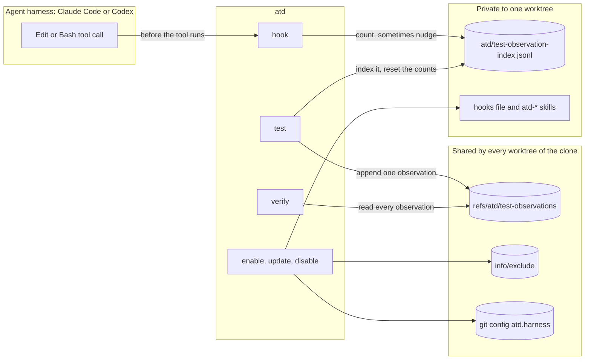
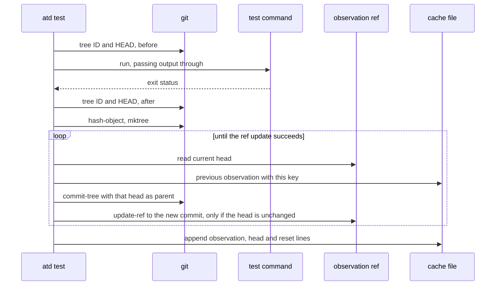
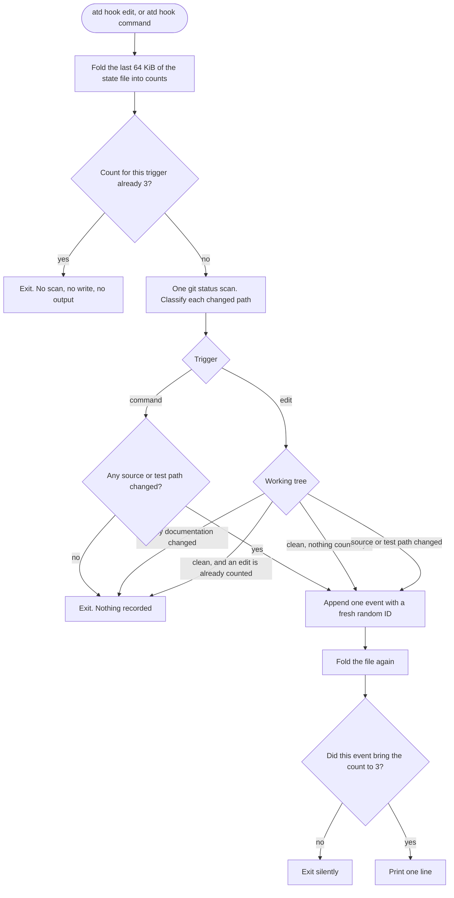
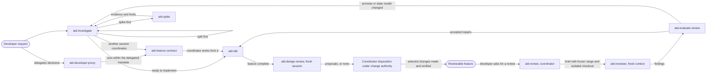

# atd internals

How atd works, mechanically: what it writes, what it compares, and what happens
when things race or break. The [README](../README.md) says why atd exists and
how to start; the [reference](reference.md) says what each command does for you.
This document is for the reader who wants to predict atd's behavior without
reading the Go.

**This is a description, not a specification.** It describes the tree it ships
in, and the full suite checks that every citation in it still points at what it
names [`TestInternalsCitations`]. Where it disagrees with the code or the tests,
it is wrong.

## How to read the citations

Every claim carries a link to the code or document that makes it true:

- `` [`workingTreeID`] ``-style links open a whole function, type, constant or
  variable, and `` [`harness.ownedHook`] ``-style links a method. A name
  starting with `Test` is the test that pins the behavior. When a claim rests
  on one branch of a longer function, the text names the condition.
- `[DIRECTION.md#steer]`-style links open a section of a Markdown file.

`script/test`, the full suite, checks every citation: a Go link's line anchor
must match the declaration's current span, a Markdown link must name an existing
heading, any other relative link must name an existing file, and no line may
link to a pinned commit. `script/test_fast` skips the check. After
code moves, `go test -run TestInternalsCitations -update` rewrites the Go
anchors; a declaration that was renamed or deleted keeps failing until the text
is fixed. The check keeps links pointing at the right code. It cannot tell
whether the prose around them is still true.

Transcripts and object IDs are real. They come from a binary built from this
tree's sources, run in throwaway repositories with Git 2.48.1 on macOS, most
recently on 2026-11-22. The only edits are that the scratch directory is
shortened to `/work`, with the length prefixes that count it adjusted to match,
and that the commit in the build's pseudo-version is elided. Statements marked
**Observed** were established by running that binary, not only by reading the
code; the link next to them points at the code responsible. [How the
observations were made](#appendix-b-how-the-observations-were-made) has the
method.

## Contents

1. [The shape of the thing](#1-the-shape-of-the-thing)
2. [One cycle, traced](#2-one-cycle-traced)
3. [Where state lives](#3-where-state-lives)
4. [Tree identity](#4-tree-identity)
5. [The observation record and its log](#5-the-observation-record-and-its-log)
6. [The cache, and how red-to-green is
   detected](#6-the-cache-and-how-red-to-green-is-detected)
7. [Steering: the hook state machine](#7-steering-the-hook-state-machine)
8. [Harness adapters](#8-harness-adapters)
9. [Install, update, status, disable](#9-install-update-status-disable)
10. [Verify](#10-verify)
11. [Version check](#11-version-check)
12. [The prose half: skills, and what backs each
    rule](#12-the-prose-half-skills-and-what-backs-each-rule)
13. [When things go wrong](#13-when-things-go-wrong)
14. [What the gates cannot see](#14-what-the-gates-cannot-see)
15. [Cost](#15-cost)

Appendices: [A, every message and exit
code](#appendix-a-every-message-and-exit-code); [B, how the observations were
made](#appendix-b-how-the-observations-were-made).

## Terms

atd's code coins a few words. They are used here as the code uses them.

| Term | Meaning | Defined at |
|---|---|---|
| Observation | The record of one `atd test` run. | [`testObservation`] |
| Stable | The file tree and `HEAD` were the same after the command as before it. | [`stableObservation`] |
| Credible red | A stable failing run in fast or targeted mode that actually launched and was not killed by a signal. | [`credibleRed`] |
| Bound red | A credible red that ran on exactly the tree of a commit in the range, while `HEAD` was that commit's only parent. | [`boundRedCommits`] |
| Gate | One of the two requirements `atd verify` enforces: a green fast run and a green full run on the candidate's tree. | [`verifyCandidate`] |
| Key | The triple (worktree path, mode, exact argument list) that decides whether two runs are "the same command". | [`testObservationIndexKey`] |
| Generation | One self-contained run of lines in the cache file, from a `start` line to its latest `head` line. | [`writeTestObservationIndexGeneration`] |
| Clean intent | A hook call for an edit that found nothing modified yet. | [`runSteeringHook`] |
| Owned | Written by atd and recognizable as such: a hook handler by its trailing marker, a skill by its hash line. | [`harness.ownedHook`], [`skillOwnershipIntact`] |
| Scope | The repository's coordination setting, `owner-controlled` or `ticket-bounded`, which the workflow skills read from `atd status`. | [`repositoryScopeStatus`] |

"Worktree" means one checked-out directory; "repository" or "clone" means the
Git directory that one or more worktrees share. The difference matters
throughout, because atd keeps some state per worktree and some per clone
[`testObservationIndexPath`], [`readExcludeFile`].

## 1. The shape of the thing

atd is one Go program with no dependencies outside the standard library
[go.mod]. It never links a Git library: every Git operation is a `git`
subprocess started through one helper, [`gitOutput`], plus two call sites that
need different handling: finding the worktree root, which runs before there is
a repository to hand the helper [`gitRoot`], and the release check, which needs
a timeout [`latestRelease`]. Reading a Git config key goes through the helper
too, in one function that both `atd.harness` and `atd.scope` use
[`gitConfigValues`]. The helper returns only Git's standard output and folds its
standard error into the error it returns
[`TestGitOutputReturnsOnlyStdoutWhenGitWarns`],
[`TestGitOutputRetainsStdoutAndStderrOnError`]. The only other process atd
starts is your test command [`executeTestCommand`]. Its one network call is the
`git ls-remote` behind `atd version --check` [`latestRelease`].

The program has four jobs, and they share state only through Git and one file
[DIRECTION.md#out-of-scope]:



The hook counts tool calls and occasionally prints one line [`runSteeringHook`]
([section 7](#7-steering-the-hook-state-machine)). `atd test` runs a command and
appends a record of it to a Git ref [`runTestCommandWithMode`] ([sections
4](#4-tree-identity) to [6](#6-the-cache-and-how-red-to-green-is-detected)).
`atd verify` reads those records and answers one question: is there a passing
fast run and a passing full run on exactly this tree [`verifyCandidate`]
([section 10](#10-verify))? The install commands put the hook and the skills
where a harness will find them [`applyInstallation`] ([sections
8](#8-harness-adapters) and [9](#9-install-update-status-disable)).

One more value sits in the shared config: the repository's scope, `atd.scope`.
`atd init --scope` writes it and `atd status` prints it [`setRepositoryScope`],
[`repositoryScopeStatus`]. Nothing else in the binary reads it; it exists for
the skills ([section 12](#12-the-prose-half-skills-and-what-backs-each-rule)).

Command dispatch is a flat `switch` [`runCLI`]. Two things are handled before
atd even checks that it is inside a repository: `version`, so it works
anywhere, and the hook entry points, so a hook fired outside a repository exits
0 and says nothing. Everything else fails with `current directory is not an
unambiguous Git repository` [`gitRoot`]. Inside one, every command works from
any subdirectory. Tests: [`TestVersionReportsBuildVersionOutsideRepository`],
[`TestSteeringCLIHookFailsOpenOutsideGit`],
[`TestRunCLIDispatchesSteeringHookFromNestedDirectory`].

## 2. One cycle, traced

This is the cycle from the README [README.md#what-a-cycle-looks-like] with the
covers off: a Go package `slug`, an acceptance test written first, then the
implementation. After each step the text shows what atd wrote.

### Setup

```console
$ atd init
initialized test scripts
$ atd test fast
atd: script/test_fast is the generated stub; replace it before running atd test fast
```

`atd init` creates `script/test_fast` and `script/test` as failing stubs
[`initializeTestScripts`]. Both hold the same text [`generatedTestScript`]:

```sh
#!/bin/sh
# Generated by atd init. Replace this stub with the repository's test command.
# Keep required test setup in project-owned scripts.
# Full-suite and targeted runs should reuse the same setup.
# Examples: browser locations, local service settings, or time limits.
# Keep secrets and machine-specific values out of tracked files.
printf '%s\n' 'atd: replace this generated test stub with the repository test command' >&2
exit 1
```

The comments are the only advice atd gives about the scripts' contents: setup a
suite needs belongs in the scripts, where a targeted run can reuse it, and the
scripts are tracked files. The runner refuses to execute a script whose bytes
still equal the stub, before it records anything [`rejectGeneratedTestStub`],
[`TestGeneratedTestStubIsRejectedBeforeExecution`]. The scripts are then
replaced with `exec go test -short -count=1 ./...` and `exec go test -count=1
./...`, committed as `fcf2c2f`, and `atd enable claude` is run. `git status`
stays empty afterwards, because atd excludes its files before creating them
([section 9](#9-install-update-status-disable)).

### Red

The agent is about to write `slug_test.go`. The harness calls the edit hook
first, and the hook finds a clean tree, so it records one clean intent and
prints nothing [`runSteeringHook`] ([section
7](#7-steering-the-hook-state-machine)). The agent writes the test and runs it:

```console
$ atd test fast
--- FAIL: TestSlugLowercasesAndHyphenates (0.00s)
    slug_test.go:7: Slug("Hello World") = "Hello World", want "hello-world"
FAIL
FAIL	example.com/slug	0.172s
FAIL
atd: test is red; if this is the intended failure, commit the test before continuing
atd: exit status 1
$ echo $?
1
```

Everything through the last `FAIL` is the test command's own output, passed
through. The `test is red` line is atd's advisory, printed on stdout once the
run is recorded [`runTestCommandWithMode`]. The final line is `main` reporting
the child's failure on stderr, and the exit code is the child's [`main`],
[`testCommandExitError.ExitStatus`].

**Observed:** that one command started 19 `git` processes, in the order
[`runTestCommandWithMode`] and [`appendTestObservation`] issue them.

| # | `git` arguments | Why |
|---|---|---|
| 1 | `rev-parse --show-toplevel` | Find the worktree root [`gitRoot`]. |
| 2–6 | `rev-parse --git-path objects`, `rev-parse HEAD^{tree}`, `read-tree`, `add -A -- .`, `write-tree` | Compute the tree ID of the working directory before the run [`workingTreeID`]. |
| 7 | `rev-parse HEAD^{commit}` | Record `HEAD` before the run [`repositoryHeadID`]. |
| | *(the test command runs here)* | [`executeTestCommand`] |
| 8–13 | the same six again | Tree ID and `HEAD` after the run [`runTestCommandWithMode`]. |
| 14–15 | `hash-object -w --stdin`, `mktree` | Store the record as a blob inside a one-entry tree [`appendTestObservation`]. |
| 16 | `rev-parse refs/atd/test-observations` | Read the log's current head; there is none yet [`testObservationHead`]. |
| 17 | `commit-tree <tree>` | Make the observation commit [`appendTestObservation`]. |
| 18 | `update-ref refs/atd/test-observations <new> 0000…0000` | Create the ref only if it still does not exist [`appendTestObservation`]. |
| 19 | `rev-parse --git-path atd/test-observation-index.jsonl` | Locate the cache file [`testObservationIndexPath`]. |

Later runs make 20: one more `rev-parse --git-path`, just before `commit-tree`,
to look up the previous observation in the cache [`previousTestObservation`],
with `-p <parent>` on `commit-tree` and the previous head as the expected old
value of `update-ref`.

The record itself is the file `observation.json` in that commit, stored on one
line [`appendTestObservation`] and indented here:

```json
{
    "schema": "atd-test-observation/v3",
    "worktree": "/work/slug",
    "before_tree": "cb0ed3f5e2961770756518f28969cf4799d4f144",
    "after_tree": "cb0ed3f5e2961770756518f28969cf4799d4f144",
    "source_changed": false,
    "before_head": "fcf2c2f58ebe35f79942b84c60b9c1cf3d28dc10",
    "after_head": "fcf2c2f58ebe35f79942b84c60b9c1cf3d28dc10",
    "history_changed": false,
    "signaled": false,
    "launch_failed": false,
    "mode": "fast",
    "command": ["./script/test_fast"],
    "exit_status": 1,
    "observed_at": "2026-11-22T14:46:20.751765Z"
}
```

`before_tree` names a tree that contains the uncommitted `slug_test.go`.
**Observed:** `git cat-file -e cb0ed3f` fails at this point. The tree object
does not exist in the repository; atd computed its ID without storing it
[`workingTreeID`] ([section 4](#4-tree-identity)).

The cache file now holds six lines: two from the hook calls, and four written by
[`appendTestObservationIndex`] when the run was recorded. Decoded:

```text
 1  steering  edit     clean            <- the edit hook, before the test file existed
 2  steering  command                   <- the command hook, before `atd test fast`
 3  index     start        gen=0e3dbf
 4  index     observation  gen=0e3dbf  mode=fast exit=1 cmd=./script/test_fast
 5  index     head         gen=0e3dbf  head=024fba1
 6  steering  reset                     <- every recorded run zeroes the hook counts
```

### Commit the red, then go green

```console
$ git add -A && git commit -qm "test: slug lowercases and hyphenates"
```

The new commit is `866d679`. Its tree is `cb0ed3f`, the ID recorded a moment
ago, and the object now exists. That equality is what later makes this red
"bound" [`TestObservedTreeMatchesDirtyWorktreeWhenItIsCommitted`].

The agent implements `Slug` and runs the same command:

```console
$ atd test fast
ok  	example.com/slug	0.085s
atd: test is green after red; commit, then refactor with tests green before the next test
```

atd printed that line because three things were true: the previous observation
with the same key was a credible red, this run exited 0, and this run was
stable. [`appendTestObservation`] answers the first two as it appends, and
[`runTestCommandWithMode`] checks the third before printing. It has no idea what
the test asserts. The agent commits (`400ee85`, tree `d764e4c`) and runs `atd
test full`, which passes.

### Verify

```console
$ atd verify --base fcf2c2f --candidate HEAD
verification gates passed
credible red observations: 1
bound red candidates: 1
  bound red: 866d67973b8b79ef8f1899e73f76d6e9ec75fbac status 1 command ["./script/test_fast"]
unbound credible reds: 0
candidate gates: fast green; full green
run anomalies (advisory): source changes 0; history changes 0; signals 0; launch failures 0
outer-red evidence is advisory review input
```

The log holds three observations, and each line of that output follows from
them:

| # | Mode | Exit | Tree before | `HEAD` before | Role in verify |
|---|---|---|---|---|---|
| 1 | fast | 1 | `cb0ed3f` | `fcf2c2f` | Bound red: commit `866d679` has parent `fcf2c2f` and tree `cb0ed3f` [`boundRedCommits`]. |
| 2 | fast | 0 | `d764e4c` | `866d679` | Fast gate. It ran *before* the implementation was committed, but on the tree the candidate has [`classifyCandidateGate`]. |
| 3 | full | 0 | `d764e4c` | `400ee85` | Full gate [`verifyCandidate`]. |

Only the last two lines of that table are gates. The red evidence is counted and
printed, and never causes a failure
[`TestVerifyLeavesMissingOuterRedForAdvisoryReview`].

By the end the cache file has 16 lines: the six above, then for each later run
the hook lines that preceded it, one `observation` and one `head` line appended
to the same generation, and a `reset` [`appendTestObservationIndex`].

## 3. Where state lives

| What | Where | Scope | Written by | If it disappears |
|---|---|---|---|---|
| Observation log | The ref [`testObservationRef`] in the clone's Git directory | Every worktree of the clone | `atd test` | Both gates fail until the suites are rerun; red evidence is gone |
| Cache and hook counts | `atd/test-observation-index.jsonl` under the worktree's own Git directory [`testObservationIndexPath`] | One worktree | `atd test` and the hooks | Rebuilt from the log on the next run; hook counts restart |
| Hook handlers | `.claude/settings.local.json` or `.codex/hooks.json`, each harness's `hooksPath` in [`harnesses`] | One worktree | `enable`, `update`, `disable` | `atd status` reports the worktree as not enabled |
| Skills | `.claude/skills/atd-*/` or `.agents/skills/atd-*/`, each harness's `skillsRoot` in [`harnesses`] | One worktree | the same | `atd update` rewrites them |
| Exclude lines | `info/exclude` of the clone [`readExcludeFile`] | Every worktree | the same | atd's files become visible to Git; `atd status` says `excludes missing` |
| Harness record | `atd.harness` in the clone's local Git config, never the global one [`harnessConfigKey`], [`TestRepositoryHarnessRecordIgnoresGlobalConfiguration`] | Every worktree | `enable`, `disable` | `atd update` no longer knows what to refresh |
| Scope | `atd.scope` in the clone's local Git config, never the global one [`repositoryScopeConfigKey`], [`TestScopeIgnoresGlobalGitConfiguration`] | Every worktree [`TestRepositoryScopeIsSharedByLinkedWorktrees`] | `atd init --scope`, or you with `git config` | `atd status` says `scope: unconfigured`, which the skills treat as no standing authority |
| Test scripts | `script/test_fast` and `script/test` [`testFastScript`], [`testFullScript`] | Tracked files in your tree | `atd init` writes stubs; you write the rest | `atd test fast` and `full` cannot start |
| Scratch space | A directory named `atd-test-tree-*` in the system temp directory [`workingTreeID`] | One tree computation | `atd test` | Nothing; it is removed before the function returns |

**Observed:** in a linked worktree named `wt`, the cache path resolves to
`.git/worktrees/wt/atd/test-observation-index.jsonl`, while the ref, the exclude
file and the config values are the main checkout's. Git decides that: atd asks
`git rev-parse --git-path` for each location and Git answers with the shared or
the private directory [`testObservationIndexPath`], [`readExcludeFile`].

**The log is shared but its cache is not.** A run in one worktree advances the
ref under every other worktree's cache, and a cache whose latest head is not the
ref's head gets rebuilt [`previousTestObservation`], so worktrees that take
turns each rebuild their cache from the whole log on every run ([section
6](#6-the-cache-and-how-red-to-green-is-detected)).

**Evidence belongs to a directory.** Every observation stores the absolute,
symlink-resolved path of the worktree it ran in, which
[`runTestCommandWithMode`] resolves before anything else, and both the gates and
the red summary ignore observations from any other path [`sameWorktree`]. A
green suite in a reviewer's scratch worktree says nothing about the same commit
in yours ([`TestCandidateGateMatchesIdentityBeforeJudgingLatestResult`], the
"different worktree" case). **Observed in a disposable repository:** after
renaming the checkout directory with `mv`, `atd verify` no longer matches either
gate observation and reports:

```text
fast: no matching record
  rerun on this worktree at the candidate's exact tree: atd test fast
full: no matching record
  rerun on this worktree at the candidate's exact tree: atd test full
atd: candidate lacks stable green fast gate and stable green full gate
```

**The log never leaves the clone on its own.** The ref is outside `refs/heads`
and `refs/tags`, so default push and fetch refspecs skip it. **Observed:** after
`git push origin main` the remote lists only `HEAD` and `refs/heads/main`, and a
fresh clone has nothing under `refs/atd`
[`TestVerifyLocalEvidenceDoesNotSurviveFreshClone`]. Git also keeps no reflog
for it under default settings (**observed:** no `logs/refs/atd`), so the commit
chain is the only history of the log.

### What is never stored

The direction document sets the rule: never persist patch contents, prompt text
or tool output [DIRECTION.md#steer]. The code keeps it structurally rather than
by filtering. An observation has no field that could hold file content
[`testObservation`], a hook event is a trigger name, a random ID and one flag
[`steeringEvent`], and the hook never reads the payload the harness sends it:
the program's only use of standard input is the `test` case of [`runCLI`],
which hands it to the test command. Tests:
[`TestSteeringStateIsMetadataOnlyAppendOnlyJSONL`],
[`TestWorkingTreeIdentityDoesNotRetainDirtySourceBlob`].

Two things *are* stored that are worth knowing about: the worktree's absolute
path, and the exact argument list of every targeted command, which
[`runTestCommandWithMode`] copies into the record. A secret passed on an `atd
test -- …` command line ends up in the ref.

## 4. Tree identity

"The exact tree" is a Git tree ID: the ID `git write-tree` would print if you
staged every file in the working directory. atd gets that ID without staging
anything. [`workingTreeID`] does this:

1. Ask Git where the clone's object store is.
2. Make a temporary directory with an empty index file and an empty object
   directory.
3. Run three Git commands with three environment overrides [`gitEnvironment`]:
   `GIT_INDEX_FILE` points at the temporary index, `GIT_OBJECT_DIRECTORY` at the
   temporary object directory, and `GIT_ALTERNATE_OBJECT_DIRECTORIES` at the real
   object store. Git therefore reads existing objects from your repository and
   writes new ones somewhere else.
4. The commands are `read-tree HEAD^{tree}` (or `read-tree --empty` when there
   is no commit), `add -A -- .`, and `write-tree`.
5. Delete the temporary directory, which a deferred call does on every return.

**Observed** in a scratch repository, by comparing the ID before and after each
change. Every row follows from the three commands in [`workingTreeID`]:

| Change in the working directory | Recorded tree ID |
|---|---|
| New file that is not ignored | Changes |
| New file that is ignored (`.gitignore`, `info/exclude`) | Unchanged |
| Empty directory | Unchanged |
| Executable bit toggled on a tracked file | Changes |
| Edit staged with `git add`, then reverted on disk | Unchanged: your index is never consulted |
| Nested Git repository | Recorded as a gitlink (mode `160000`) to its `HEAD` commit |
| Uncommitted edit inside that nested repository | Unchanged |
| File matched by a clean filter | The filter runs and its output is what gets hashed |

**The ID of a dirty tree equals the ID of the commit you then make from it.**
That is why a suite run before `git commit` satisfies a gate for the commit, and
why a red can be matched to the commit that captured it
[`TestObservedTreeMatchesDirtyWorktreeWhenItIsCommitted`].

**The record can name a tree that does not exist.** New blobs and trees go to
the temporary object directory and are deleted with it, so after a run on a
dirty tree the recorded ID resolves to nothing until you commit that exact
content. This is how atd identifies uncommitted work without keeping a copy of
it [`TestWorkingTreeIdentityDoesNotRetainDirtySourceBlob`]. **Observed:** the
bytes of `.git/index` are identical before and after a run on a dirty tree.

**Ignored files are outside the identity, so atd's own files must be ignored.**
Otherwise the hooks file, with this machine's path to the binary in it, would be
part of every recorded tree and no commit would ever match. `enable` adds the
exclude lines before it creates any file [`applyInstallation`], and refuses to
install over a path Git already tracks, because excluding a tracked file hides
nothing [`trackedHarnessFiles`].

**Nested repositories are opaque.** A linked worktree placed inside the working
directory would be recorded as a gitlink that changes whenever that worktree's
`HEAD` moves. Claude Code puts its subagent worktrees under
`.claude/worktrees/`, which is why that path is in the Claude exclude list,
Claude's `hostExcludes` in [`harnesses`]
([`TestClaudeAgentWorktreesStayOutOfCandidateGates`]). **Observed:** a
registered submodule behaves the same way. An uncommitted edit inside it leaves
the recorded tree unchanged, although `git status` reports the submodule as
modified.

The computation is not free of side effects on the real repository, and **these
were observed** rather than read from atd's code, since they are Git's behavior
under the `add -A` in [`workingTreeID`]:

- The computation adds no object, but the modification time of every existing
  object Git re-encounters is refreshed, loose objects and packs alike.
- A `post-index-change` hook fires for each write of the temporary index: six
  times per `atd test`.
- A clean filter runs for every file it matches, changed or not, once per
  computation, and twice in a run that immediately followed the files being
  written. A repository with filtered files pays for that on every run.

It is also not cheap on a large tree. The temporary index starts with no cached
file metadata, so `add -A` has to read and hash every tracked file. Measured on
a synthetic repository of 100,000 small files, that step took 2.0 s, against
0.10 s for the same command with the real index, and [`runTestCommandWithMode`]
does it twice, before and after the command. See [section 15](#15-cost).

`HEAD` is recorded alongside the tree with `rev-parse --verify --quiet
HEAD^{commit}` [`repositoryHeadID`]. That has no fallback for a repository with
no commits. **Observed:** there, `atd test` stops with `identifying HEAD before
command: git rev-parse --verify --quiet HEAD^{commit}: exit status 1:`, the
trailing colon introducing Git's empty error output, even though the tree
computation before it handles the empty case with `read-tree --empty`
[`workingTreeID`].

## 5. The observation record and its log

### Fields

| Field | Value | Source |
|---|---|---|
| `schema` | Always `atd-test-observation/v3`; readers reject anything else | [`testObservationSchema`] |
| `worktree` | Absolute, symlink-resolved worktree root | [`runTestCommandWithMode`] |
| `before_tree`, `after_tree` | Tree IDs from [section 4](#4-tree-identity), computed before and after the command | [`runTestCommandWithMode`] |
| `source_changed` | `before_tree != after_tree` | [`runTestCommandWithMode`] |
| `before_head`, `after_head` | Commit IDs of `HEAD` | [`repositoryHeadID`] |
| `history_changed` | `before_head != after_head` | [`runTestCommandWithMode`] |
| `signaled` | The command died from a signal | [`testCommandWasSignaled`] |
| `launch_failed` | The command could not be started at all | [`executeTestCommand`] |
| `mode` | `fast`, `full` or `targeted` | [`testMode`] |
| `command` | The argument list as executed; for fast and full always `./script/test_fast` or `./script/test` | [`parseTestCommand`] |
| `exit_status` | See the mapping below | [`executeTestCommand`] |
| `observed_at` | UTC time with nanoseconds, taken after the command finished | [`runTestCommandWithMode`] |

`observed_at` is informational. Nothing orders observations by it; order is the
ancestry of the commits that hold them, oldest first, as `git rev-list
--reverse` lists them [`localTestObservations`]. The "later red despite older
clock" case in [`TestCandidateGateMatchesIdentityBeforeJudgingLatestResult`]
pins that.

### How the command runs

`atd test fast` and `atd test full` run the two registered scripts and nothing
else; any other command needs the `--` separator and is recorded as `targeted`
[`parseTestCommand`], [`TestTestModesRunRegisteredScripts`],
[`TestTestRejectsUnknownModeAndRequiresTargetedSeparator`]. The argument list is
executed directly, without a shell, with the worktree root as its working
directory [`executeTestCommand`],
[`TestRunTestCommandStreamsOutputPreservesStatusAndRecordsObservation`].
**Observed:** `atd test -- pwd` from `sub/dir` prints the worktree root, so
relative paths in a targeted command are relative to the root wherever you
invoke it.

Standard input and standard error are atd's own, passed straight through.
Standard output goes through a small wrapper that remembers whether the last
byte written was a newline [`lineTrackingWriter.Write`], so atd can put its
advisory on a fresh line without adding a blank one
[`lineTrackingWriter.needsNewline`],
[`TestRunTestCommandDoesNotAddBlankLineBeforeNudge`]. The wrapper has a cost.
**Observed** under a pseudo-terminal: the command sees a terminal on descriptors
0 and 2 and a pipe on descriptor 1, so a test tool that colors its output only
when stdout is a terminal will not color it under `atd test`.

| What happened | `exit_status` | Flag | How [`executeTestCommand`] tells |
|---|---|---|---|
| The command exited with status N | N | | Go reports exit code N |
| It was killed by signal S | 128 + S | `signaled` | No exit code, and the wait status says signaled |
| It was not found, or its interpreter was not found | 127 | `launch_failed` | The start error is `exec.ErrNotFound` or `os.ErrNotExist` |
| It could not be started for any other reason | 126 | `launch_failed` | Any other start error |

The flags matter because the numbers alone are ambiguous. A command that runs
and itself exits 127 is an ordinary failing test, while a command that was never
found is not evidence of anything. Only the first is a credible red
[`TestExecutedChildStatuses126And127AreCredibleRed`],
[`TestRunTestCommandUsesShellStatusesForLaunchFailures`],
[`TestRunTestCommandMapsInvalidExecutableLaunchFailureTo126`],
[`TestRunTestCommandMapsMissingInterpreterLaunchFailureTo127`],
[`TestRunTestCommandPersistsSignalState`]. **Observed:** `sh -c 'kill -TERM $$'`
records 143 with `signaled`; a file without the executable bit records 126, and
a script whose `#!` interpreter is missing records 127, as does a command that
is not on `PATH`, all with `launch_failed`. `sh -c 'exit 127'` records a plain
127 and gets the red advisory.

### What `atd test` reports and returns

The observation is appended first; what atd prints and returns is decided
afterwards, at the end of [`runTestCommandWithMode`]. So an unstable or killed
run is still on the record. Nonzero codes travel as a [`testCommandExitError`],
whose status `main` exits with.

| Outcome of the run | Advisory on stdout | Exit code of `atd test` |
|---|---|---|
| Passed, stable, and the previous run with the same key was a credible red | `test is green after red; commit, then refactor with tests green before the next test` | 0 |
| Passed, stable, otherwise | none | 0 |
| Credible red [`credibleRed`] | `test is red; if this is the intended failure, commit the test before continuing` | the command's |
| Failed in `full` mode | none | the command's |
| Killed by a signal, or failed to launch | none | 128 + S, 127 or 126 |
| Tree or `HEAD` changed during the run, command passed | none | 1 |
| Tree or `HEAD` changed during the run, command failed with N | none | N |
| The observation could not be recorded | none | the command's if nonzero, else 1 |

Changing files or history during a run is treated as a failure of the run, not
of the test: the result is recorded with `source_changed` or `history_changed`
set and can satisfy nothing
[`TestRunTestCommandFailsClosedAndDoesNotNudgeWhenGreenCommandChangesSource`],
[`TestRunTestCommandPreservesNonzeroStatusWhenCommandChangesSource`],
[`TestRunTestCommandFailsClosedWhenCommandMovesHEAD`]. A run that changes
neither is recorded with identical before and after IDs
[`TestRunTestCommandPersistsStableBeforeAndAfterTrees`]. Only the two endpoints
are compared. **Observed:** a command that creates a file and deletes it again
is recorded as stable.

A full run gets neither advisory. `credibleRed` admits only fast and targeted
modes, so a failing full run is not a credible red, and a passing one never
follows a credible red with the same key [`credibleRed`],
[`TestFullModeDoesNotIssueCommitOrRefactoringAdvisories`]. Signaled runs and
launch failures get no advisory either
[`TestRunTestCommandDoesNotAdviseOnExcludedFailures`]. The code does not say
why.

### Storage: one commit per observation

```text
refs/atd/test-observations
        │
        ▼
   commit 1e62313 ──parent──► commit 7338511 ──parent──► commit 024fba1
        │                          │                          │
      tree                       tree                       tree
        └─ observation.json        └─ observation.json        └─ observation.json
```

```console
$ git cat-file -p 024fba1
tree e1975345a7a34eeec4a1efbb461106dcf20db34a
author atd <atd@localhost> 1795358780 +0000
committer atd <atd@localhost> 1795358780 +0000

atd test observation
$ git ls-tree 024fba1
100644 blob 6e05be4551d0e5df9482aa85c040342cb9237354	observation.json
```

The record is written as a blob, wrapped in a tree with that single entry, and
committed with the previous head as its parent, under a fixed author and message
[`appendTestObservation`], [`TestObservationsAppendToGitHistory`]. These are
ordinary Git objects, reachable from the ref, so `git log
refs/atd/test-observations` lists them and garbage collection keeps them
(**observed** with `git gc --prune=now`). They have no relationship to your
branches.

**Observed** about how Git treats these commits, which [`appendTestObservation`]
makes with `commit-tree` and `update-ref`: they are not signed even with
`commit.gpgSign` set, because `commit-tree` is plumbing; of your Git hooks only
`reference-transaction` fires for the ref update, twice per run (alongside the
`post-index-change` calls from [section 4](#4-tree-identity)); no commit hook
runs.

### Appending without losing a record



The last step of the loop is a compare-and-swap. `git update-ref <ref> <new>
<old>` changes the ref only if it still holds `<old>`, and an all-zero `<old>`
means "only if it does not exist". When another `atd test` got there first, Git
refuses, and [`appendTestObservation`] goes round again: it rereads the head,
looks up the previous observation again (the answer may have changed), and
builds a new commit on the new parent.

Which refusals are retried is decided by matching Git's error text:

| Git said | Meaning | atd's response | Code |
|---|---|---|---|
| `cannot lock ref` with `is at … but expected …`, or with `reference already exists` | Someone else appended | Retry with no deadline; each retry makes progress against a new head | [`refUpdateCASContention`] |
| `cannot lock ref` with `File exists` | Another process holds the ref's lock file right now | Retry for up to 5 seconds | [`refUpdateLockContention`] |
| Anything else | | Fail the append | [`appendTestObservation`] |

Waits start at 10 ms and double up to 250 ms [`appendTestObservation`]. Tests:
[`TestConcurrentTestObservationsAreNotLost`] runs 32 at once, and
[`TestAppendTestObservationOutlastsTransientRefContention`] holds the lock file
for two seconds. **Observed:** 16 concurrent `atd test -- true` processes all
succeeded and left a linear chain of 16 commits.

The text matching is the fragile part. atd does not force a locale on Git
[`gitEnvironment`]. **Observed** with this Git under `LC_ALL=de_DE.UTF-8`: the
outer message is translated (`Schwerwiegend: update_ref für Referenz …
fehlgeschlagen`), while the fragments atd matches stay in English. `File exists`
is the C library's text for an error code, and stayed English on macOS. A system
whose C library translates it would turn lock contention into an immediate
failure; that has not been tested.

### Reading

Nothing checks a record when it is written; [`appendTestObservation`]
serializes whatever it is given. `atd verify` checks every record in the log
each time it runs, in order, stopping at the first rule a record breaks
[`validateTestObservation`]: a non-empty worktree, the schema string, the four
IDs as 40 or 64 lowercase hex digits (SHA-1 and SHA-256 repositories)
[`validVerifierObjectID`], the two `_changed` flags agreeing with the IDs, a
known mode, a non-empty command, an exit status from 0 to 255, `signaled` and
`launch_failed` not both set, 129 to 192 when `signaled`, 126 or 127 when
`launch_failed`, and an RFC 3339 timestamp. One bad record fails the whole
verification, with a message naming its commit and the rule, such as `local
observation <id> mode must be fast, full, or targeted` [`localTestObservations`],
[`TestValidateTestObservationIdentifiesInvalidField`],
[`TestLocalTestObservationsRetainsInvalidRecordContext`] ([section
13](#13-when-things-go-wrong)).

## 6. The cache, and how red-to-green is detected

To print `green after red`, `atd test` needs the previous observation with the
same key. Walking the log to find it would cost one `git` process per record, so
atd keeps the latest observation per key in a file and reads that instead. A
warm lookup costs one `git` process, the one that locates the file, however long
the log is [`TestPreviousTestObservationWarmLookupUsesConstantGitProcesses`].

The key joins the worktree path, the mode and each argument, each prefixed by
its length [`testObservationIndexKey`], for example
`10:/work/slug4:fast18:./script/test_fast`. The prefixes keep `["a b"]` and
`["a", "b"]` apart. Matching is exact: `go test -run TestA ./...` and `go test
-run TestB ./...` are different commands, a fast run and a targeted run of the
same script are different commands
[`TestPreviousObservationMatchesModeExactly`], and the same command in another
worktree is a different command [`TestRunTestCommandNudgeRequiresSameWorktree`].

### File format

The file is JSON Lines, append-only, and it carries two unrelated kinds of
record: the cache described here, and the hook counts from [section
7](#7-steering-the-hook-state-machine). They share a file because the direction
allows atd exactly one state file of its own besides what it keeps in Git
[DIRECTION.md#out-of-scope],
[`TestSteeringUsesTheObservationIndexAsItsOnlyStateFile`]. Each reader skips
lines whose `record` field is not its own
[`loadTestObservationIndexGeneration`], [`loadSteeringState`].

```json
{"record":"atd-observation-index/v1","kind":"start","generation":"0e3dbf7d84252826ccb0c8600baaa9a4"}
{"record":"atd-observation-index/v1","kind":"observation","generation":"0e3d…","key":"10:/work/slug4:fast18:./script/test_fast","observation":{…}}
{"record":"atd-observation-index/v1","kind":"head","generation":"0e3dbf7d84252826ccb0c8600baaa9a4","head":"024fba12a28947881dde9dad557cf16485d2cc5b"}
{"record":"atd-steering/v1","trigger":"reset"}
```

(The second line is shortened; `observation` holds the whole record from
[section 5](#5-the-observation-record-and-its-log).)

A **generation** is a `start` line, any number of `observation` lines, and
`head` lines saying "everything above is the state of the log at this commit". A
full rebuild writes a new generation in one append: `start`, one observation per
key, `head` [`writeTestObservationIndexGeneration`]. Each run after that appends
one `observation` and one `head` to the same generation, but only if the file's
latest `head` is the commit this run built on [`appendTestObservationIndex`].
If it is not, another writer got in between and the run appends nothing; the
next reader will notice the mismatch.

### Reading it

The reader goes backwards from the end of the file in 4 KiB steps
[`visitReverseJSONLFileLines`], and [`loadTestObservationIndexGeneration`]
handles each line it meets:

1. The first valid `head` line is the marker.
2. Continuing backwards, it collects `observation` lines of the marker's
   generation, keeping the first one seen per key, which is the newest.
3. It stops at that generation's `start` line. Without one the generation is
   incomplete and unusable.

The cache is **current** when the generation is complete and the marker's commit
is the ref's head [`loadTestObservationIndexFile`]. Anything else triggers a
rebuild: `git rev-list --reverse` over the log and one `git show` per
observation, the last one per key winning, then a fresh generation appended to
the file [`rebuildTestObservationIndex`].

**Observed** process counts for one `atd test`, with N observations in the log
(the lookup is [`previousTestObservation`]):

| Situation | `git` processes |
|---|---|
| Cache current | 20 [`loadTestObservationIndexFile`] |
| Cache file deleted | 22 + N, then 20 again [`TestPreviousTestObservationRebuildsAfterCacheDeletion`] |
| Ref moved by something other than this worktree's last run | 22 + N [`TestPreviousTestObservationRebuildsAfterObservationRefChanges`] |
| Two worktrees taking turns | 22 + N on every run in both: one ref, two cache files [`testObservationIndexPath`] |
| Half-written line at the end of the file | 20: the fragment is skipped [`TestPreviousTestObservationRepairsPartialCacheWrite`] |
| The latest `head` line cut short | 22 + N once, then 20: the marker found is the older `head`, which is not the ref's head [`loadTestObservationIndexFile`] |

The turn-taking row is the consequence promised in [section
3](#3-where-state-lives). Each `git show` in [`rebuildTestObservationIndex`]
costs about 4 ms ([section 15](#15-cost)), so with a thousand observations in
the log every run in an alternating pair of worktrees spends about four extra
seconds.

### What the file tolerates

Writers do not lock, and every cache write is best-effort: errors are dropped on
the floor [`appendTestObservationIndex`],
[`writeTestObservationIndexGeneration`]. The direction accepts lost, reordered
or malformed cache lines because the ref, which is protected by
compare-and-swap, is the truth [DIRECTION.md#out-of-scope]. Three mechanisms
make that safe:

- A line that does not parse, or lacks required fields, is skipped
  [`loadTestObservationIndexGeneration`].
- Before appending, the writer checks the file's last byte and starts with a
  newline if a previous write was cut off mid-line, so the damage is confined to
  one line [`appendJSONL`], [`TestSteeringStateRecoversAfterTornWrite`].
- Generations are identified by a random ID [`stateEventID`], and the reader
  keeps only lines of the marker's generation, so interleaved lines from two
  writers cannot be mistaken for one generation
  [`loadTestObservationIndexGeneration`].

The file is never truncated or compacted [`appendJSONL`]. **Observed:** 16
concurrent runs started on a log of 22 observations raced each other into 36
rebuilds, and the file had grown to 78 KB with 38 observations in the log, all
under one key. A rebuild writes a line per key, so a log with many distinct
commands grows the file faster. Reads stay cheap regardless, since they only
walk back to the latest `start`
[`TestPreviousTestObservationLoadsLargeEventGeneration`]. Deleting the file is
the way to shrink it.

### The red-to-green rule

`green after red` is printed when all of these hold. [`appendTestObservation`]
checks the first three as it appends, and [`runTestCommandWithMode`] the last:

- the cache has a previous observation for this exact key,
- that observation is a credible red,
- this run exited 0,
- this run was stable.

So the comparison is with the *immediately previous* run of the same command,
not with any earlier red, and the green that follows gets nothing.
[`TestRunTestCommandNudgesWhenSameCommandTurnsGreen`] is the positive case, in
targeted and fast mode, and these are the negative ones:

| Sequence for one key | Advisory on the last run | Test |
|---|---|---|
| green (first ever) | none | [`TestRunTestCommandDoesNotNudgeFirstOrRepeatedGreenOrDifferentCommand`] |
| red, then a *different* command green | none | [`TestRunTestCommandDoesNotNudgeFirstOrRepeatedGreenOrDifferentCommand`] |
| red, green, green | none | [`TestRunTestCommandNudgesWhenSameCommandTurnsGreen`] |
| killed by a signal, then green | none | [`TestRunTestCommandDoesNotNudgeAfterSignaledFailure`] |
| failed to launch, green | none | [`TestRunTestCommandDoesNotNudgeAfterLaunchFailure`] |
| red, green that modified a file | none, and exit 1 | [`TestRunTestCommandFailsClosedAndDoesNotNudgeWhenGreenCommandChangesSource`] |

`test is red` has no memory at all: every credible red prints it, including the
tenth in a row [`runTestCommandWithMode`],
[`TestRunTestCommandAdvisesOnStableRedFailure`].

## 7. Steering: the hook state machine

The harness runs `atd` before every edit tool call and every shell tool call.
atd answers from two inputs only: one `git status` scan and the tail of its
state file. It does not look at what the tool is about to do. The direction
calls the hook a dumb trigger without payload parsing [DIRECTION.md#steer], and
the install test feeds it a payload reading `payload is ignored` to prove the
point [`assertHookDeliversContextForTest`].

There are two triggers, `edit` and `command`, each with its own count and a
threshold of three, which [`runSteeringHook`] checks before it scans. The whole
procedure is [`runSteeringHook`]:



### The fold

State is not stored; it is recomputed on every call by reading the last 64 KiB
of the file [`boundedJSONLTail`] and applying each steering line in order
[`loadSteeringState`]:

- `reset` zeroes both counts.
- `edit` adds one to the edit count, except that a second `edit` marked `clean`
  is ignored.
- `command` adds one to the command count.
- The event that takes a count to exactly three is remembered by its ID as that
  trigger's *adviser*.

After appending its own event, the hook folds again and prints only if it is the
adviser [`runSteeringHook`]. That is what makes the nudge fire once.
**Observed:** ten hooks started together with the count at two all appended an
event, and exactly one printed
[`TestSteeringAdvisoryBelongsToFirstThresholdEvent`].

### Clean intents

The hook runs before the tool, so the first edit after a commit is judged
against a clean tree. It is recorded with `clean: true` and counted once.
Further edit calls while the tree is still clean are not recorded at all:
[`runSteeringHook`] returns before appending when the tree is clean and an edit
is already counted. If several were recorded by racing hooks, the fold counts
one [`TestSteeringHookCountsOnlyOneCleanEditIntent`],
[`TestSteeringFoldCountsConcurrentCleanIntentsOnce`].

**Observed**, calling the plain-text hook by hand; each row is one pass through
[`runSteeringHook`]:

| Working tree | Call | Output | Steering lines in file | `git` processes |
|---|---|---|---|---|
| clean | `edit` | | 1 | 3 |
| clean | `edit` | | 1 | 3 |
| `feature.go` modified | `edit` | | 2 | 3 |
| `feature.go` modified | `edit` | `atd: source edits are accumulating…` | 3 | 3 |
| `feature.go` modified | `edit` | | 3 | 2 |
| *(`atd test -- true`)* | | | 4: a `reset` line | |
| `feature.go` modified | `edit` | | 5 | 3 |
| `feature.go` modified | `edit` | | 6 | 3 |
| `feature.go` modified | `edit` | `atd: source edits are accumulating…` | 7 | 3 |
| *(`git commit`)* | | | | |
| clean, then modified again | `edit` ×3 | | 7 | 2 |

The nudge arrives with the third counted edit since the last recorded run. Past
the threshold the hook skips the scan, which is why it drops to two `git`
processes [`TestSteeringHookScansWorktreeOnceAndNotAfterThreshold`]. And a
commit does not reset anything: only a recorded run does.

### Classifying paths

The scan is `git status --porcelain -z --untracked-files=all`, which lists
staged, unstaged and untracked paths in one pass; for a rename or copy the old
path is skipped so the change is judged by its new name
[`steeringChangedPaths`], [`TestSteeringHookClassifiesStagedRenamesByNewPath`].
Each path is tested for "test" first, then for "documentation", and is source
otherwise [`steeringChanges`].

| Class | Rule | Code |
|---|---|---|
| Test | In or under a directory named `tests`, `test`, `spec` or `__tests__`; or the file name starts with `test_`, contains `.test.`, `.spec.`, `_test.` or `_spec.`, or ends with `test.java`; or the path is `script/test` or `script/test_fast` | [`steeringTestPath`] |
| Documentation | Under `docs/` or `doc/`; or the file name starts with `readme`; or ends with `.md`, `.mdx`, `.rst` or `.adoc` | [`steeringDocumentationPath`] |
| Source | Everything else | [`steeringChanges`] |

These are name heuristics and they misfire. **Observed** by creating each file
and reading which nudge came back, so each row is the verdict of
[`steeringTestPath`] and [`steeringDocumentationPath`]:

| Path | Classified as |
|---|---|
| `pkg/foo_test.go`, `script/test` | test |
| `tests/README.md`, `docs/tests/plan.md` | test, because the test rule is checked first |
| `src/Latest.java`, `src/Contest.java` | test, because the names end in `test.java` |
| `test.py`, `conftest.py`, `testdata/input.go` | source |
| `src/FooTests.swift`, `src/FooTest.kt` | source |
| `docs/tool.py` | documentation, so never counted |
| `.agents/skills/tdd/SKILL.md` | documentation, so never counted |

The last row has a consequence in atd's own repository: the skill sources are
Markdown compiled into the binary [`embeddedSkillFiles`], and editing them never
moves a count. The stakes of a misclassification are low either way, since the
class only selects which line is printed, or whether one is
[`TestSteeringHookRecognizesCommonTestPaths`],
[`TestSteeringHookIgnoresDocumentationOnlyChanges`].

### The three nudges

[`runSteeringHook`] prints one of these at a trigger's third event:

| Trigger | Condition | Line |
|---|---|---|
| `edit` | a source path is changed | `atd: source edits are accumulating without an observed test; run atd test fast` |
| `edit` | only test paths are changed | `atd: run the changed test with atd test fast or atd test -- <command> and confirm the intended red` |
| `command` | source or test paths are changed | `atd: if this command runs tests, use atd test fast, full, or -- <command> so the result is observed` |

Tests: [`TestSteeringHookNudgesOnceAtSourceEditThreshold`],
[`TestSteeringHookDistinguishesTestOnlyChanges`],
[`TestSteeringCommandHookNudgesOnceAfterThreeCommands`],
[`TestSteeringCommandHookIgnoresCleanTree`].

The command trigger counts every shell call made while code is changed: `ls`,
`git status`, and `atd test` itself. [`runSteeringHook`] skips a command call
only when no source or test path is changed. **Observed:** with the command
count at two, a hook call whose payload said the command was `atd test fast`
printed the third nudge. The hook cannot know; it never read the payload.

### Reset

Every recorded run ends by appending a `reset` line to the cache file of the
worktree it ran in, in any mode and whatever the result: once
[`appendTestObservationIndex`] has located the file, it defers
[`appendSteeringReset`]. One reset clears both counts. A run in another
worktree writes to another file and resets nothing here
[`TestSteeringHookResetsAfterObservedTest`],
[`TestSteeringTestResetIsScopedToItsWorktree`]. Since the command is not
inspected, `atd test -- true` is as good a reset as a real test.

### Failing open

The hook never fails the tool call it precedes. Every error path in
[`runSteeringHook`] returns success with no output: no state path, unreadable
state, a failing `git status`, no random ID, a failed append
[`TestSteeringHookFailsOpenOnOperationalError`]. Outside a repository the hook
exits 0 before doing anything, in the hook branches of [`runCLI`]. The price is
that failures are invisible. **Observed:** with the state directory made
read-only, the hook stayed silent through any number of edits, because it could
never record the events it needed to count.

The state file's growth from hooks is bounded: once a trigger is past its
threshold it writes nothing more until the next reset
[`TestSteeringStateStaysBoundedAfterAdvisory`], and a command call on a clean or
documentation-only tree writes nothing ever
[`TestSteeringDoesNotWriteStateForCleanCommands`].

## 8. Harness adapters

Supporting a harness means knowing where it keeps hooks and skills, what its
tools are called, and what a hook should print. In atd all of that is data: the
per-harness code is one struct literal [`harnesses`], and the functions that
install and run hooks take it as a parameter.

| | Claude Code | Codex |
|---|---|---|
| Hooks file | `.claude/settings.local.json` | `.codex/hooks.json` |
| Skills directory | `.claude/skills` | `.agents/skills` |
| Shell-tool matcher | `Bash` | `^Bash$` |
| Edit-tool matcher | `Edit\|Write\|NotebookEdit` | `^(apply_patch\|Edit\|Write)$` |
| Internal subcommand | `_claude-hook` | `_codex-hook` |
| Extra handler field | none | `"async": false` |
| Extra exclude pattern | `/.claude/worktrees/` | none |
| Printed after enabling | start a new session | review and trust the hooks with `/hooks` |

Both harnesses are hooked at the same event, `PreToolUse`
[`harness.hookMarker`], [`reconciledHooks`]. The matchers are written to select
one family of tools each and nothing else: the install test checks each matcher
against tools it must not select, such as `Read`, `Agent` and MCP filesystem
tools [`assertInstalledHooksForTest`], [`harnessesForTest`]. An edit made
through a shell command (`sed -i`, a formatter) therefore counts as a command,
and an edit made through an MCP tool counts as nothing.

### What gets written

**Observed:** `atd enable codex` in a repository with no `.codex` directory
produces this file, mode `0600` [`harness.hookGroups`], [`hooksFileMode`]:

```json
{
  "hooks": {
    "PreToolUse": [
      {
        "hooks": [
          {
            "async": false,
            "command": "'/work/bin/atd' _codex-hook command # atd:codex-pre-tool-use:command:v1",
            "timeout": 10,
            "type": "command"
          }
        ],
        "matcher": "^Bash$"
      },
      {
        "hooks": [
          {
            "async": false,
            "command": "'/work/bin/atd' _codex-hook edit # atd:codex-pre-tool-use:edit:v1",
            "timeout": 10,
            "type": "command"
          }
        ],
        "matcher": "^(apply_patch|Edit|Write)$"
      }
    ]
  }
}
```

The `command` string has four parts [`harness.hookHandler`]:

1. The absolute path of the binary that ran `enable`, single-quoted for the
   shell [`currentATDPath`], [`shellQuote`]. Move or reinstall the binary and
   the hooks point at the old location until `atd update` rewrites them.
2. The internal subcommand for this harness.
3. The trigger, `command` or `edit`.
4. A shell comment, `# atd:<harness>-pre-tool-use:<trigger>:v1`
   [`harness.hookMarker`].

The comment is the ownership mark. The shell discards it, and atd recognizes its
own handlers by testing whether a command string *ends with* one of the two
markers [`harness.ownedHook`]. Nothing else identifies a handler as atd's: not
its position, not its matcher, not the path. That is why `update` can replace a
handler that points at a different binary, and why handlers you add beside
atd's, even in the same group, are left alone
[`TestUpdateReconcilesOwnedHooks`].

### What the hook prints

`_claude-hook` and `_codex-hook` run the same state machine as `atd hook`, and
the internal-hook branch of [`runCLI`] wraps a non-empty result in one JSON
object [`writeHookContext`]. **Observed:** both adapters print byte-identical
output:

```json
{"hookSpecificOutput":{"additionalContext":"atd: source edits are accumulating without an observed test; run atd test fast","hookEventName":"PreToolUse"}}
```

The encoder escapes HTML characters, so the command nudge's `<command>` arrives
as `<command>`, which any JSON reader decodes back (**observed**).
When there is no nudge the adapters print nothing. The object carries context
and nothing else: there is no permission decision in it, and the hook's exit
code is 0, or 1 for a malformed invocation [`main`]. atd has no way to refuse a
tool call, which is what the README means by nudges being advisory
[README.md#status-and-limitations]. Tests:
[`TestClaudeHookDeliversSteeringContext`], [`TestHookContextIsJSONEncoded`].

### Merging into a file that already exists

Both hooks files are JSON objects that may hold settings atd knows nothing
about. atd decodes the file generically, touches only `hooks.PreToolUse`, and
writes everything back [`readHookConfiguration`], [`reconciledHooks`],
[`TestEnableInstallsWorkingHooksWithoutReplacingExistingConfiguration`]:

- its own handlers are removed from wherever they are, and a group left with no
  handlers and no keys besides `matcher` and `hooks` is dropped
  [`withoutOwnedHooks`];
- every other group, handler and field is kept, and atd's two groups are
  appended after them [`reconciledHooks`].

Preservation is of meaning, not of bytes, because the file is decoded into
generic maps and encoded again [`decodeHookConfiguration`],
[`encodeHookConfiguration`]. **Observed** on a hand-written
`settings.local.json`:

| In the existing file | After `atd enable` |
|---|---|
| Unknown top-level keys, other hook events, your own `PreToolUse` groups | Kept |
| `1.50`, a 30-digit integer | Kept digit for digit, because the decoder keeps numbers as text [`decodeHookConfiguration`] |
| `<`, `>` and `&` inside strings | Left unescaped [`encodeHookConfiguration`] |
| Key order | Alphabetical at every level |
| Indentation | Two spaces [`encodeHookConfiguration`] |
| The same key twice in one object | The later value survives; the earlier is gone |
| File mode `0640` | Kept; a file atd creates gets `0600` [`readHookConfiguration`], [`hooksFileMode`] |

A file atd cannot read as a single JSON object is never rewritten. `enable`
stops with a message naming what was wrong and leaves it exactly as it was
[`TestEnableLeavesMalformedConfigurationUnchanged`]. **Observed** refusals: a
`//` comment, a top-level array, `"hooks"` that is not an object, `"PreToolUse"`
that is not an array, and two JSON values in one file
[`decodeHookConfiguration`], [`preToolUseGroups`].

## 9. Install, update, status, disable

### Plan first, write second

`enable` and `update` compute everything they intend to write before writing any
of it [`planInstallation`]. The plan includes a list of *refusals*: files at
atd's target paths that atd may not overwrite. If the list is non-empty, nothing
is written at all [`refuseEditedSkills`], and [`updateHarnesses`] builds the
plans for every recorded harness before applying the first one. Tests:
[`TestUpdateRefusesHandEditedSkillsBeforeWritingAnything`],
[`TestUpdateChecksEveryHarnessBeforeWritingAny`],
[`TestEnableRefusesExistingForeignSkillBeforeWritingAnything`].

[`planInstallation`] collects two kinds of refusal:

- **A path Git tracks.** Exclusion cannot hide a tracked file, so writing one
  would put this machine's binary path, or atd's skills, into your diffs and
  into every recorded tree [`trackedHarnessFiles`],
  [`TestEnableAndUpdateRefuseTrackedHarnessFiles`]. **Observed:** a repository
  that commits `.codex/hooks.json` cannot enable Codex: `refusing to write files
  atd does not own: .codex/hooks.json (tracked by Git); move them aside and
  retry`.
- **An `atd-*` skill atd did not write, or that was edited since**, listed as
  `(edited or not written by atd)`.

Paths are also checked for symlinks on the way down: any directory component
that is a symlink, or a hooks file that is not a regular file, stops the command
before anything outside the repository could be touched
[`requireRealDirectories`], [`readHookConfiguration`],
[`TestEnableRejectsUnsafeConfigurationPaths`].

### The order of writes

[`applyInstallation`] writes in this order:

1. Exclude patterns into the clone's `info/exclude`, under a `# atd <harness>`
   line [`addExcludePatterns`].
2. Removal of temporary files left by an earlier interrupted run
   [`removeLeftoverTemporaryFiles`].
3. Each skill that is stale or missing.
4. Removal of skills this binary no longer ships.
5. The hooks file.
6. The `atd.harness` value in Git config [`recordRepositoryHarness`].

Excluding first means no failure partway can leave atd's files visible to Git
[`TestATDFilesStayExcludedWhenWritesFail`]. Writing the hooks file near the end
matters for a different reason: "is this worktree enabled?" is answered by
looking for an owned handler in that file and nothing else [`enableHarness`],
[`inspectWorktree`]. An install that dies before step 5 leaves a worktree that
still counts as not enabled, so running `enable` again does the whole job rather
than reporting that there is nothing to do.

Each file is written to a sibling temporary file named `.atd-*`, then renamed
into place [`writeFileAtomically`]. A killed atd can leave such a file behind.
Readers skip them, the next write removes them, and the exclude list hides them
in the meantime [`temporaryFile`], [`harness.excludePatterns`],
[`TestInterruptedWritesDoNotBlockUpdateOrDisable`].

**Observed** exclude block after enabling both harnesses, each harness's
patterns under its marker line [`harness.excludePatterns`],
[`harness.excludeMarker`]:

```text
# atd codex
/.codex/hooks.json
/.codex/.atd-*
/.agents/skills/atd-*/
# atd claude
/.claude/settings.local.json
/.claude/.atd-*
/.claude/skills/atd-*/
/.claude/worktrees/
```

### Skills: rendering and ownership

The skills are Markdown files under `.agents/skills/`, compiled into the
binary [`embeddedSkillFiles`]. Installation does not copy them verbatim.
[`renderSkills`] makes three changes, and **this is the observed diff** between
the source and installed `investigate` skill:

```diff
2c2
< name: investigate
---
> name: atd-investigate
39c39
< Use the [review contract](../review/SKILL.md#finding-record-and-continuity) to
---
> Use the [review contract](../atd-review/SKILL.md#finding-record-and-continuity) to
43c43
< [spike](../spike/SKILL.md) before planning the dependent work.
---
> [spike](../atd-spike/SKILL.md) before planning the dependent work.
49c49
< ready to implement, use [tdd](../tdd/SKILL.md) and follow existing authorization
---
> ready to implement, use [tdd](../atd-tdd/SKILL.md) and follow existing authorization
52c52
< [feature contract](../feature-contract/SKILL.md). Otherwise no plan file is needed;
---
> [feature contract](../atd-feature-contract/SKILL.md). Otherwise no plan file is needed;
89a90
> <!-- atd-managed sha256:edf0f729debcc4f53c6c8c564c27ede6e8857d040b78f682f8bc9ab8aef0ff4b -->
```

The `name:` in the front matter gains the `atd-` prefix, links to sibling skills
are pointed at the prefixed copies, and a final comment line carries the SHA-256
of everything above it [`renderSkill`], [`withSkillOwnership`]. The Claude and
Codex copies are byte-identical.

Rendering is strict about links. A link that is neither external, nor an in-page
anchor, nor a sibling `../<skill>/SKILL.md` with an optional heading anchor
makes rendering fail [`renderSkill`]. A skill therefore cannot refer to anything
that would not exist in someone else's repository, in keeping with the
direction's rule that installation must not carry this repository's own
instructions [DIRECTION.md#what-atd-is]. Each embedded skill must also be a
directory holding exactly one file, `SKILL.md` [`renderSkills`], whose front
matter declares its own directory name [`renderSkill`].

The hash line is how atd tells its files from yours. [`skillOwnershipIntact`]
recomputes the hash of the body and compares. Every entry named `atd-*` in the
skills directory is then put in one of five states [`inspectSkills`],
[`readOwnedSkill`]:

| State | Meaning | `enable` / `update` | `disable` |
|---|---|---|---|
| current | Identical to what this binary would write | leaves it | removes it |
| stale | Hash line intact, content from another version | rewrites it | removes it |
| missing | Absent, or a directory with nothing in it but temporary files | writes it | removes the directory |
| retired | Hash line intact, but this binary ships no skill of that name | deletes it | removes it |
| edited | Anything else: changed by hand, extra files, not a directory, or simply someone else's `atd-…` skill | refuses to write anything | refuses unless `--force` |

**Observed:** appending one line to an installed skill makes `atd status` list
it under `skills edited`, and both `update` and `disable` stop without changing
a file until the skill is moved aside or `--force` is given
[`TestDisableRefusesEditedSkillsUnlessForced`]. Tests for the other transitions:
[`TestUpdateRefreshesStaleFilesAndPrunesRetiredSkills`],
[`TestReviewerInstructionsAreReachableAfterEnableAndUpdate`].

One oddity comes from Codex reading skills from `.agents/skills`, the same
directory the sources live in. In an atd checkout with Codex enabled, the
installed `atd-*` copies sit beside the sources and would be compiled into a
locally built binary as if they were skills. [`renderSkills`] skips them by
prefix [`TestEnableIgnoresInstalledCopiesBesideSourceSkills`].

### `enable`, `update` and `status`

`enable` acts on one worktree. If the hooks file already has an owned handler,
[`enableHarness`] only makes sure the harness is recorded and tells you to use
`update` [`TestEnableRecordsHarnessForUnrecordedHooks`]. `update` acts on every
harness named in `atd.harness`, in the current worktree, and installs into a
worktree that has nothing yet, which is how a new linked worktree is brought up
[`updateHarnesses`]. With no harness recorded it fails and points at `enable`
[`TestUpdateRequiresEnabledHarness`]. A name in the record that this binary
does not know blocks `update` only, and `status` prints the `git config`
command that removes it [`repositoryHarnesses`], [`unknownHarnessNotices`],
[`TestUnknownHarnessRecordIsReportedWithoutBlockingEnableOrStatus`]. When an
update changes a Codex hook command, [`updateHarnesses`] reminds you that Codex
needs the hooks trusted again
[`TestUpdateRequestsCodexTrustWhenHookCommandChanges`].

`status` prints the build version, the scope, and one line per known harness
[`writeStatus`], [`harnessStatus`]. **Observed** lines, from several states:

```text
atd v0.1.1-0.20261122141626-…
scope: owner-controlled
claude: repository enabled; worktree enabled; hooks current; skills current
claude: repository enabled; worktree enabled; hooks stale; skills current; run atd update
claude: repository enabled; worktree enabled; hooks current; skills edited atd-mine, atd-tdd; run atd update
claude: repository enabled; worktree enabled; hooks current; skills missing atd-review; run atd update
claude: repository enabled; worktree not enabled; run atd enable claude
codex: repository not enabled; worktree not enabled
```

"Hooks stale" means the owned handlers differ from what *this* binary would
write, which includes pointing at a different path [`inspectWorktree`],
[`sameOwnedHookHandlers`]. `status` checks the files atd wrote, not whether a
harness has loaded them or, for Codex, trusted them [docs/reference.md#codex],
[`TestStatusReportsRepositoryAndWorktreeEnablement`]. The scope line is the
subject of [`atd init` and scope](#atd-init-and-scope) below.

### `disable`

[`disableHarness`] checks before it changes anything: an unreadable hooks file,
an edited skill without `--force`, or a tracked file it would have to modify
each stop it with the worktree untouched
[`TestDisableRefusesBeforeWritingAnything`]. A tracked hooks file that holds no
atd handler needs no change and is left as it is
[`TestDisableLeavesTrackedHooksWithoutATDHandlers`]. Then, in order:

1. Leftover temporary files are removed [`removeLeftoverTemporaryFiles`].
2. The hooks file is rewritten without atd's handlers. If nothing at all remains
   in it, the file is deleted [`writeHooksWithout`].
3. Every `atd-*` skill directory is removed.
4. Only if no other worktree of the clone still has this harness installed, the
   exclude lines and the `atd.harness` value are removed
   [`removeExcludePatterns`], [`unrecordRepositoryHarness`].

Step 4 exists because those two things are shared. Removing the exclude lines
while another worktree still has atd's files would make them show up there as
untracked changes [`TestDisableKeepsExcludesHidingAnotherWorktreesSkills`],
[`TestDisableKeepsSharedStateWhileAnotherWorktreeHasHarness`],
[`TestDisableClearsRepositoryRecordNoWorktreeUses`]. [`worktreesUsing`] decides
by inspecting each worktree Git lists: a worktree whose directory is gone does
not count, and one that cannot be inspected does, so that its files stay
excluded. **Observed:**

```console
$ atd disable claude
disabled atd for Claude Code in this worktree
kept the shared Git exclude entries and atd.harness record; Claude Code remains in /work/inst-wt
```

Exclude lines are removed conservatively: only the marker line and the atd
patterns directly beneath it go, so an identical line you added yourself
elsewhere in the file stays [`removeExcludePatterns`],
[`TestUpdateAddsNewClaudeExcludesAndPreservesDeveloperExcludes`].

`disable` returns the worktree to its earlier *meaning*, not its earlier bytes
[`TestDisableRestoresWorktreeToItsStateBeforeEnable`]. A settings file that
existed before keeps the sorted, re-indented form `enable` gave it, and the
directories atd created remain, empty.

### `atd init` and scope

`init` is separate from all of the above and touches no harness
[`TestOrdinaryInitDoesNotEnableHarnesses`]. It creates `script/` if needed and
the two stub scripts if they are missing, with exclusive creation so an existing
file is never overwritten [`createTestScriptIfMissing`],
[`TestInitCreatesFastAndFullTestScripts`],
[`TestInitPreservesExistingTestScripts`]. It refuses a `script` path that is a
symlink, and an existing script that is a symlink, not a regular file, or not
executable [`validateTestScript`], [`TestInitRejectsUnsafeScriptPaths`],
[`TestInitRejectsExistingNonExecutableTestScript`]. The same check runs every
time `atd test fast` or `full` starts [`rejectGeneratedTestStub`],
[`TestRegisteredModeRejectsUnsafeScriptBeforeObservation`].

With `--scope owner-controlled` or `--scope ticket-bounded`, `init` also sets
the repository's scope. The order makes it safe to rerun: the `init` case of
[`runCLI`] checks the argument before anything is written [`parseInitScope`],
creates or validates the scripts next, and only then writes `atd.scope`, with
`git config --local --replace-all`, so whatever values were there before, valid
or not, become one [`setRepositoryScope`]. A bad argument therefore writes
nothing [`TestInitRejectsInvalidScopeBeforeWritingScriptsOrConfiguration`], a
script problem leaves the scope as it was
[`TestInitDoesNotChangeScopeWhenScriptValidationFails`], existing scripts are
kept [`TestInitSetsAndExplicitlyChangesRepositoryScopeWithoutReplacingScripts`],
and plain `atd init` never touches the scope
[`TestInitWithoutScopePreservesTheExistingScope`].

`status` reads every local value of the key [`gitConfigValues`] and reports one
of three things [`repositoryScopeStatus`],
[`TestStatusDoesNotGrantAuthorityForUnknownOrDuplicateScope`]. **Observed:**

```console
$ atd status | sed -n 2p
scope: unconfigured
$ atd init --scope owner-controlled
initialized test scripts
$ atd status | sed -n 2p
scope: owner-controlled
$ git config --local --add atd.scope ticket-bounded
$ atd status | sed -n 2p
scope: invalid; repair with atd init --scope owner-controlled or atd init --scope ticket-bounded
```

Two values are invalid even when both are recognized names, and so is any
single value other than the two names. Global config is ignored
[`TestScopeIgnoresGlobalGitConfiguration`]. The value lives in the clone's
config, so linked worktrees share it
[`TestRepositoryScopeIsSharedByLinkedWorktrees`] and `enable`, `update` and
`disable` leave it alone [`TestHarnessLifecyclePreservesRepositoryScope`], but
a fresh clone starts without it. That is why the skills carry the value, and
where it was read, in their briefs to other sessions ([section
12](#12-the-prose-half-skills-and-what-backs-each-rule)). The binary itself
never acts on it.

## 10. Verify

`atd verify --base <commit> --candidate <commit>` reads the log and answers
whether the candidate may be called done. It writes nothing. [`verifyCandidate`]
proceeds in this order:

1. Resolve both arguments to commits. Anything `git rev-parse` accepts works: a
   branch, a tag, a short ID [`resolveCommit`].
2. Require the base to be an ancestor of the candidate. The two may be the same
   commit [`commitIsAncestor`].
3. List the commits after the base up to the candidate [`commitsInRange`].
4. Load and validate every observation in the log [`localTestObservations`].
5. Work out the advisory red evidence [`boundRedCommits`],
   [`relevantRedObservationHeads`].
6. Classify both registered gates against the candidate's tree
   [`commitTree`], [`classifyCandidateGate`].
7. If either gate is invalid, report both gate results and recommend rerunning
   only invalid gates. Otherwise print the success summary
   [`printCandidateGateResults`], [`printVerificationSummary`].

### The gate

A gate is one call to [`classifyCandidateGate`]. It walks the observations from
newest to oldest and stops at the first one that matches on all four of:

- `before_tree` equals the candidate commit's tree,
- the mode (`fast` or `full`),
- the command, exactly `["./script/test_fast"]` or `["./script/test"]`,
- the worktree `atd verify` is running in.

That single observation decides. The gate passes if it exited 0, was not
signaled, did not fail to launch, and was stable. Otherwise `atd verify`
reports whether it failed, changed files, changed history, or has no matching
record. Identity is matched before the result is looked at, so a newer failure
on the same tree cancels an older pass, and a newer pass restores it
[`TestCandidateGateMatchesIdentityBeforeJudgingLatestResult`],
[`TestVerifyUsesLatestCandidateGateObservation`]. Both gates are required; one
is not enough [`TestVerifyRequiresBothCandidateGates`]. This is the direction's
"latest observation by ref append order" rule [DIRECTION.md#verify].

**Observed** near misses and hits, each a different way of matching or missing
the four conditions in [`classifyCandidateGate`]:

| Run | Counts for the gate? |
|---|---|
| `atd test fast` on a dirty tree, committed afterwards without further edits | Yes [`TestVerifyAllowsStablePreCommitGreenForUnchangedCandidateTree`] |
| The same script through `atd test -- ./script/test_fast` | No: the mode is `targeted`, and mode and command must match exactly [`TestVerifyRequiresExactRegisteredGateCommand`] |
| Both suites green in another worktree at the same commit | No |
| Green, then a later red on the same tree | No, until it is green again |
| A passing suite that wrote a file into the tree | No: `atd test` itself exited 1 |
| Green on the previous commit; the candidate adds one file | No [`TestVerifyRejectsStaleCandidateEvidence`] |

### Evidence follows the tree, not the commit

The gate never compares commit IDs. The only thing it takes from the candidate
is its tree [`commitTree`]. **Observed** consequences:

- The candidate need not be `HEAD`. An older commit verifies if its tree was
  tested.
- Reverting a commit restores the earlier tree, and with it the earlier
  evidence: `atd verify` passed on the revert with no new run.
- Amending only a commit message keeps the tree, so the gates still pass.
- A different commit on a different branch with the same tree passes too.

`--base` plays no part in the gates. It is checked for ancestry and it bounds
the advisory summary, nothing more [`verifyCandidate`].

### The advisory summary

On success, the red summary is information for a reviewer. The direction is
explicit that missing or odd red evidence is review input and never grounds for
rejection [DIRECTION.md#verify].

| Line | Definition | Code |
|---|---|---|
| `credible red observations` | Distinct credible reds from this worktree whose `before_head` is a *relevant head*: the base, a commit in the range, or the only parent of one. "Distinct" means differing in `before_head`, `before_tree`, mode, command or exit status, so repeating a failing run adds nothing. | [`relevantRedObservationHeads`], [`redObservationKey`], [`printVerificationSummary`] |
| `bound red candidates` | Pairs of a range commit and a credible red, where the commit has exactly one parent, the red ran with `HEAD` at that parent, and the red's tree is the commit's tree. In words: someone ran a failing test and then committed exactly what they had run. | [`boundRedCommits`] |
| `bound red:` lines | The first five pairs, with the command cut to 120 characters. | [`maxBoundRedSummary`], [`summarizeCommand`] |
| `unbound credible reds` | Credible reds that are not bound to any commit; typically inner-cycle failures that were fixed before committing. | [`printVerificationSummary`] |
| `run anomalies` | Counts, over the same scope, of runs that changed the tree, changed `HEAD`, were signaled, or failed to launch. | [`printVerificationSummary`] |

Merge commits can sit in the range but can never be bound, having more than one
parent [`commitParent`], [`TestVerifyAllowsMergeInRange`],
[`TestVerifyScopesMergedBranchRedThatPredatesBase`]. Other tests:
[`TestVerifyReportsBoundRedAsAdvisoryAndRequiresExactCandidateGates`],
[`TestVerifyLeavesUnmatchedInnerRedsAdvisory`],
[`TestVerifyBoundsRedCandidateOutput`],
[`TestVerifyScopesRedSummaryToCurrentRange`],
[`TestVerifyReportsExecutionAnomaliesAsAdvisory`],
[`TestVerificationAnomalySummaryIsScopedAndBounded`].

Binding is by parent and tree, not by the commit's own ID [`boundRedCommits`],
and red evidence is scoped by commit IDs: an observation is counted only if its
`before_head` is a relevant head [`printVerificationSummary`]. **Observed:**
amending the message of the commit that captured a red leaves it bound, listed
under its new ID. Rewriting every commit ID in the range while keeping the trees
(a forced rebase) leaves both gates passing and drops the summary to `credible
red observations: 0` for reds recorded at a rewritten commit, because their
`before_head` values no longer appear in the range. A red recorded with `HEAD`
at the base itself stays bound, since the base is not rewritten.

### Output

On success the unchanged summary goes to stdout and the exit code is 0. If a
gate is invalid, stdout reports both gate results and gives a rerun command only
for each invalid gate, bound to this worktree and the candidate's exact tree;
stderr names the missing stable green gate, and the exit code is 1. **Observed
in a disposable repository** with a failed fast run and a passing full run:

```text
fast: failed (exit status 1)
  rerun on this worktree at the candidate's exact tree: atd test fast
full: passed
atd: candidate lacks stable green fast gate
```

A gate with no matching record says `no matching record`; an unstable
observation says `changed files`, `changed history`, or both. The red summary
remains success-only [`verifyCandidate`],
[`printCandidateGateResults`], [`TestCLIVerifyReportsEachInvalidGateAndNextCommand`],
[`TestCLIVerifyReportsChangedFilesAndHistoryForBothGates`].

Verification reads every record [`localTestObservations`], so its cost grows
with the log: **observed** 8 + N + 3C `git` processes for N observations and C
commits in the range ([section 15](#15-cost)).

## 11. Version check

`atd version` prints the module version Go stamped into the binary, or `(devel)`
when there is none [`buildVersion`]. A binary built from a checkout carries a
pseudo-version such as `v0.1.1-0.20261122141626-…`.

`atd version --check` lists the tags of the release repository with `git
ls-remote --tags --refs`, takes the highest tag of the form `vX.Y.Z` ignoring
prereleases and other tags, and compares its three numbers with the build's
[`latestRelease`], [`parseVersion`], [`checkVersion`]. The comparison leans on
how Go names development builds, as the comment on [`checkVersion`] explains: a
pseudo-version carries the *next* patch number after the release it was built
on, so a larger number means the build is newer than the release and an equal
number means it predates it.

**Observed** with this development build, by pointing the release URL at a local
repository with Git's `insteadOf` rewriting, the mechanism the code names for
private access [`releaseRepository`]:

| Tags on the remote | Output | Exit |
|---|---|---|
| none, or only `v3-final` and `v0.2.0-rc1` | `could not check for releases: … has no vX.Y.Z tags` | 1 |
| `v0.1.0` | `atd v0.1.1-0.2026… is a development build newer than the latest release v0.1.0` | 0 |
| `v0.1.1` | `atd v0.1.1-0.2026… is older than the latest release v0.1.1; run go install …@v0.1.1, then atd update in enabled worktrees` | 1 |
| unreachable | `could not check … for releases (it needs the same GitHub access as go install; …)` | 1 |

The call cannot hang. Credential prompts are disabled, Git is told to give up on
a stalled HTTP transfer, and the whole command is cancelled after 20 seconds
[`latestRelease`], [`releaseCheckTimeout`]. A build whose version cannot be
parsed, such as `(devel)`, is reported as not comparable and exits 1
[`checkVersion`] (**observed** with a build made without version control
information). Tests: [`TestVersionCheckComparesWithLatestReleaseTag`],
[`TestVersionCheckReportsUnreachableReleases`],
[`TestVersionCheckTimesOutOnStalledRemote`].

## 12. The prose half: skills, and what backs each rule

Everything above is the binary. The rest of atd is nine Markdown skills that
tell an agent how to work [`sourceSkillNamesForTest`], and the binary knows
nothing about what they say: it renders, installs and hashes them
[`renderSkills`] ([section 9](#9-install-update-status-disable)) and never reads
a word of their instructions.



The README's table says what each skill is for [README.md#how-it-works]. The
parts of each that carry its procedure are: the four questions and the
change-authority rule in investigate
[.agents/skills/investigate/SKILL.md#investigate-a-change],
[.agents/skills/investigate/SKILL.md#change-authority]; the brief, the limits on
conduct and the hand-back in spike [.agents/skills/spike/SKILL.md#brief],
[.agents/skills/spike/SKILL.md#conduct],
[.agents/skills/spike/SKILL.md#hand-back]; the contents, readiness bar and
coordinator steps in feature-contract
[.agents/skills/feature-contract/SKILL.md#contents],
[.agents/skills/feature-contract/SKILL.md#working-from-a-contract]; the role
split, test validity, the cycle and the design-review handoff in tdd
[.agents/skills/tdd/SKILL.md#roles],
[.agents/skills/tdd/SKILL.md#test-validity],
[.agents/skills/tdd/SKILL.md#cycle],
[.agents/skills/tdd/SKILL.md#separate-design-review]; what to judge and the
proposal format in design-review
[.agents/skills/design-review/SKILL.md#judge-the-design],
[.agents/skills/design-review/SKILL.md#return-a-decision-ready-result];
readiness, the brief and acceptance of results in review
[.agents/skills/review/SKILL.md#readiness-and-launch],
[.agents/skills/review/SKILL.md#return-and-disposition]; method, experiments and
the result format in reviewer
[.agents/skills/reviewer/SKILL.md#independently-review-a-frozen-change],
[.agents/skills/reviewer/SKILL.md#diagnostic-experiments],
[.agents/skills/reviewer/SKILL.md#result]; and finding families in
evaluate-review [.agents/skills/evaluate-review/SKILL.md#evaluate-a-review].

Two stages sit between a green feature and final review. At feature completion
the coordinator arranges a design review in a separate, fresh session, which
returns proposals about names, APIs and responsibility boundaries and edits
nothing [.agents/skills/tdd/SKILL.md#separate-design-review],
[.agents/skills/design-review/SKILL.md#review-a-features-design]. The
coordinator then decides on the proposals under the repository's scope:
`owner-controlled` lets it select worthwhile ones, `ticket-bounded` only what
the ticket requires plus changes that need no substantial extra verification,
and `unconfigured` or `invalid` leaves the choice to the user or an expressly
authorized proxy [.agents/skills/investigate/SKILL.md#change-authority].
Selected changes go through tdd and are verified, and the final reviewer is
independent of the design reviewer as well as of the implementer
[.agents/skills/review/SKILL.md#coordinate-an-adversarial-review].

Which of these rules does anything mechanical stand behind? Very few:

| Rule | Where it is written | What backs it |
|---|---|---|
| Fast and full suites pass on the exact tree being delivered | [DIRECTION.md#verify] | **Gate**, if someone runs `atd verify`. Nothing runs it for you [README.md#status-and-limitations]. |
| Run tests through `atd test` | [README.md#how-it-works] | **Nudge** on the third shell call with code changed; and runs outside atd satisfy no gate. |
| Observe each red and green through a test run rather than piling up edits | [.agents/skills/tdd/SKILL.md#cycle] | **Nudge** on the third edit. |
| Confirm the intended failure and commit the outer red before implementing | [.agents/skills/tdd/SKILL.md#cycle] | **Runner output** (`test is red…`), then the bound-red count in `atd verify`. Advisory. |
| Commit when the test goes green, then refactor with tests green | [README.md#how-it-works], [.agents/skills/tdd/SKILL.md#cycle] | **Runner output** (`test is green after red; commit, then refactor…`). Advisory. |
| A test command must not change the tree or history | [docs/reference.md#nudges] | **Runner**: the run exits nonzero and can satisfy nothing. |
| Installed skills are not edited in place | [docs/reference.md#updating] | **Installer**: `update` and `disable` refuse. |
| The repository's scope decides how far the coordinator may go without asking | [.agents/skills/investigate/SKILL.md#change-authority] | **Status line**: `atd status` reports `atd.scope`. The binary never acts on it. |
| Investigate before coding | [.agents/skills/investigate/SKILL.md#investigate-a-change] | Prose only. |
| A feature contract states end state and decisions, never steps or pseudocode | [.agents/skills/feature-contract/SKILL.md#contents] | Prose only. The binary neither creates nor reads contracts. |
| The acceptance test goes through the consumer's boundary and could fail for a real bug | [.agents/skills/tdd/SKILL.md#cycle], [.agents/skills/tdd/SKILL.md#test-validity] | Prose only. atd sees exit codes, not assertions. |
| A consumer workflow is tested through its documented entry point, with only the setup the consumer has | [.agents/skills/tdd/SKILL.md#test-validity] | Prose only. |
| A separate, fresh-context design review at feature completion, whose proposals do not authorize edits | [.agents/skills/tdd/SKILL.md#separate-design-review], [.agents/skills/design-review/SKILL.md#review-a-features-design] | Prose only. atd adds no design gate or approval state. |
| A review happens only when the developer asks | [.agents/skills/review/SKILL.md#coordinate-an-adversarial-review] | Prose only. |
| The reviewer has fresh context and wrote neither the code nor the design review | [.agents/skills/review/SKILL.md#coordinate-an-adversarial-review] | Prose only; it depends on how the harness starts the reviewer. |
| The reviewed range is frozen and experiments run in an isolated checkout | [.agents/skills/review/SKILL.md#readiness-and-launch] | Prose only. |
| Never claim gates passed without evidence bound to that head | [.agents/skills/review/SKILL.md#readiness-and-launch] | Prose; `atd verify` is where such evidence comes from. |
| The reviewer does not repair, and restores the baseline between experiments | [.agents/skills/reviewer/SKILL.md#independently-review-a-frozen-change], [.agents/skills/reviewer/SKILL.md#diagnostic-experiments] | Prose only. |
| At changed boundaries, the reviewer checks where the consumer's semantics differ from the implementation's representation | [.agents/skills/reviewer/SKILL.md#independently-review-a-frozen-change] | Prose only. |
| A mutation counts as killed only if it builds, the test runs and the intended assertion fails | [.agents/skills/reviewer/SKILL.md#diagnostic-experiments] | Prose only. |
| Reject a result whose reviewed head is stale; check the tree is unchanged and experiments were undone | [.agents/skills/review/SKILL.md#return-and-disposition] | Prose only; the coordinator checks with Git by hand. |
| Judge findings before fixing; after a second accepted finding in a family, revisit the design | [.agents/skills/evaluate-review/SKILL.md#evaluate-a-review] | Prose only. |
| Keep one row per finding in a record | [.agents/skills/review/SKILL.md#return-and-disposition] | Prose only. The binary neither creates nor reads the record. |

So the binary enforces three things, hints at four, reports one, and leaves the
rest to the model following instructions. That division is the design, not an
omission: atd keeps no registry of tests, slices or approvals, and treats
adversarial review as the answer to what tests cannot catch
[DIRECTION.md#review]. It is also why the README says review quality depends on
the model you run it on [README.md#status-and-limitations].

Three details connect the skills back to the mechanics. The reviewer's isolated
checkout is a different worktree, so by [section 3](#3-where-state-lives) the
suites it runs there count for nothing in the coordinator's checkout, and each
side's runs make the other's cache rebuild. The scope comes from local Git
config, which a linked worktree shares and a clone lacks, so the skills tell the
coordinator to read it in the primary workspace and to pass the value and that
path in every brief to another session
[.agents/skills/investigate/SKILL.md#change-authority]. And the fallback finding
record, `.atd/reviews/<id>.md`, and feature contracts and spike briefs under
`.atd/features/`, are created and Git-excluded by the agent following the
skills; `atd enable` deliberately does not create them
[.agents/skills/review/SKILL.md#finding-record-and-continuity],
[.agents/skills/feature-contract/SKILL.md#feature-contract]. Being ignored, they
are outside every recorded tree and do not travel to another checkout, which is
why the briefs pass their paths.

The tests hold the skills to structural promises: after `enable` or `update` the
reviewer's and the design reviewer's instructions exist as their own installed
files; review links to the installed reviewer; tdd links to the installed
design-review skill and, in its design-review handoff, to the feature contract;
and tdd, design-review and feature-contract all link to the installed
change-authority section [`TestReviewerInstructionsAreReachableAfterEnableAndUpdate`].

## 13. When things go wrong

Each row was **observed** in a scratch repository unless a test is named.

| Situation | What happens | Why |
|---|---|---|
| Two `atd test` runs finish at the same moment | Both are recorded, one after the other. Each may rebuild the cache. | [`appendTestObservation`], [`TestConcurrentTestObservationsAreNotLost`] |
| atd is killed during a run (`SIGTERM`, or a harness timeout that kills only atd) | Nothing is recorded. The test command keeps running as an orphan; atd does not tie its lifetime to its own. | [`runTestCommandWithMode`] records only after [`executeTestCommand`] returns |
| Ctrl-C in a terminal, which signals the whole foreground group | atd and the command both die. Nothing is recorded. | The same |
| Only the test command is killed | Recorded with `signaled` and status 128 + S; `atd test` exits with that status. | [`executeTestCommand`] |
| The Git object store is not writable, as in some sandboxes | The command runs, then recording fails. A *passing* command makes `atd test` exit 1 with `recording test observation: …`; a failing one keeps its own status. | The recording-failure branch of [`runTestCommandWithMode`] |
| The cache directory is not writable | Runs still record. Lookups rebuild from the log whenever the cache is stale, which with nothing able to update it is every run. Hooks never nudge. | Cache and hook writes are best-effort [`appendTestObservationIndex`], [`runSteeringHook`] |
| The cache file is deleted, truncated or has garbage in it | It is rebuilt or the bad lines are skipped. | [`rebuildTestObservationIndex`]; [section 6](#6-the-cache-and-how-red-to-green-is-detected) |
| The observation ref is deleted | Both gates fail until the suites are rerun. Red evidence is gone for good. | [`testObservationHead`], [`localTestObservations`] |
| The log contains a record with a different schema string | `atd verify` fails naming the commit: `local observation <id> uses unsupported schema "…"`. `atd test` fails to record whenever it needs a rebuild: `recording test observation: decoding test observation <id>`. The way out is deleting the ref and rerunning the suites. | [`validateTestObservation`], [`rebuildTestObservationIndex`]. There is deliberately no migration [DIRECTION.md#out-of-scope] |
| The log contains a record that breaks another rule | `atd verify` fails naming the commit and the rule, such as `local observation <id> mode must be fast, full, or targeted`. `atd test` keeps recording on top of it, since a rebuild checks only the schema. | [`validateTestObservation`], [`rebuildTestObservationIndex`] |
| The repository has no commit yet | `atd test` stops before running anything. | [`repositoryHeadID`] |
| The checkout directory is renamed | All of its evidence stops matching. | [`sameWorktree`] |
| The atd binary is moved or reinstalled elsewhere | Installed hooks still name the old path. `atd status` from the new binary says `hooks stale`; `atd update` rewrites them. | [`currentATDPath`], [`inspectWorktree`] |
| `enable` or `update` is interrupted | Temporary files may remain; they are hidden from Git and removed by the next run. The worktree counts as enabled only once the hooks file was written. | [`TestInterruptedWritesDoNotBlockUpdateOrDisable`] |
| A linked worktree is added after enabling | It has no hooks or skills: they are untracked files and do not come along. `atd status` there says `worktree not enabled`; `atd update` or `atd enable` installs them. | [`TestEnableInstallsSkillsInLinkedWorktreeOnly`], [`TestStatusReportsRepositoryAndWorktreeEnablement`] |
| The repository is cloned fresh | There is no log, and `atd status` says `scope: unconfigured`. Run both suites, then verify; the red counts will be zero. | [`TestVerifyLocalEvidenceDoesNotSurviveFreshClone`], [`repositoryScopeStatus`] |
| The test command edits a file or moves `HEAD` | Recorded, flagged, exit nonzero, counts for nothing. | [`runTestCommandWithMode`] |

The reference adds one harness-side behavior this repository's code cannot show:
Claude Code also loads the main checkout's hooks and skills in a linked
worktree, so stale hooks in the main checkout can produce a second hook there
[docs/reference.md#worktrees].

## 14. What the gates cannot see

atd is built for capable models acting in good faith. The direction says to
include inexpensive safeguards against shortcuts and to demand evidence before
spending real effort on more [DIRECTION.md#what-atd-is]. So the list below is
not a set of vulnerabilities; it is the boundary of what a green `atd verify`
tells you. Each item was **observed** to pass verification unless noted.

- **Anything not run through atd.** A suite run directly leaves no record. The
  only pressure against it is one nudge per stretch of work ([section
  7](#7-steering-the-hook-state-machine)).
- **Nobody ran `atd verify`.** No hook, commit check or CI step invokes it
  [README.md#status-and-limitations].
- **The environment.** An observation has no field for environment variables,
  tool versions, the network or the clock [`testObservation`]. A suite that
  skips its checks when `SKIP_CHECKS` is set recorded two green runs under
  `SKIP_CHECKS=1 atd test …`, indistinguishable from honest ones; after an
  honest red, the first of them even printed `test is green after red`.
- **Ignored files.** They are outside the tree ID [`workingTreeID`] ([section
  4](#4-tree-identity)). A suite whose result depended on an ignored `.env` file
  passed with the file present, on a tree where it otherwise fails.
- **Uncommitted state inside nested repositories and submodules**, for the same
  reason.
- **Changes made and undone within one run.** Only the endpoints are compared
  [`runTestCommandWithMode`] ([section 5](#5-the-observation-record-and-its-log)).
- **What the suite covers.** `script/test` is whatever you put in it, and the
  gate is exactly as strong. The scripts are tracked files, so weakening one
  changes the tree and shows up in the diff, but nothing judges whether the
  script is adequate [docs/reference.md#test-scripts].
- **Flakiness.** One pass is enough. "Stable" describes the tree, not the result
  [`stableObservation`].
- **The log itself.** It is an ordinary local ref with no signature or checksum
  beyond Git's own, and reading it checks only the shape of each record
  [`validateTestObservation`]. Moving the ref back one commit erased a red and
  let an older green decide. Two observation commits written by hand with `git
  hash-object`, `git mktree` and `git commit-tree` satisfied both gates for a
  tree that had never passed. The compare-and-swap in [section
  5](#5-the-observation-record-and-its-log) protects against losing records by
  accident, not against editing them on purpose.
- **The hooks.** They live in an untracked, excluded settings file that an agent
  can edit [`harness.excludePatterns`], and `atd test -- true` resets both
  counts [`appendSteeringReset`] ([section
  7](#7-steering-the-hook-state-machine)).

What does hold: a recorded green is bound to an exact tree, which includes the
test scripts and every tracked test file. Changing a test, a script or a line of
source after the run produces a different tree, and the evidence no longer
applies [`TestVerifyRejectsStaleCandidateEvidence`]. That is the one shortcut
the gate is built to close, and the README names it: a pass on some earlier
version of the code doesn't count [README.md#how-it-works].

## 15. Cost

Counts of `git` processes are exact and were **observed** with a logging
wrapper; every one of them goes through [`gitOutput`] or the call sites named in
[section 1](#1-the-shape-of-the-thing). Times are medians on one Apple-silicon
Mac with Git 2.48.1, measured on 2026-11-22, and are good for orders of
magnitude only.

| Operation | `git` processes |
|---|---|
| Hook that scans | 3 [`TestSteeringHookScansWorktreeOnceAndNotAfterThreshold`] |
| Hook past its threshold | 2 [`runSteeringHook`] |
| `atd test`, first ever in the clone | 19, plus your command: with no log yet there is nothing to look up [`previousTestObservation`] |
| `atd test`, cache current | 20 [`runTestCommandWithMode`] |
| `atd test`, cache stale or missing | 22 + N [`rebuildTestObservationIndex`] |
| `atd verify` | 8 + N + 3C [`localTestObservations`], [`boundRedCommits`] |

N is the number of observations in the log and C the number of commits in the
verified range.

In a repository with four tracked files, one `git` process took about 3.6 ms and
`atd` itself about 2.4 ms to start. The three rows are [`runSteeringHook`] with
and without its scan, and [`runTestCommandWithMode`] around a command that does
nothing:

| Operation | Time |
|---|---|
| Hook that scans | 14 ms |
| Hook past its threshold | 10 ms |
| `atd test -- true` | 84 ms |

**The log is never pruned, and two operations read all of it**: verification
[`localTestObservations`] and a cache rebuild [`rebuildTestObservationIndex`].
Extending a log with copies of a real observation gave:

| Observations in the log | `atd verify` | `atd test`, cache current | `atd test`, cache stale |
|---|---|---|---|
| 50 | 0.23 s | 0.08 s | 0.32 s |
| 200 | 0.82 s | 0.08 s | 0.91 s |
| 1,000 | 4.0 s | 0.08 s | 4.1 s |
| 5,000 | 20 s | 0.09 s | 20 s |

A stale cache is the normal case when two worktrees share a clone and take
turns, each with its own cache file [`testObservationIndexPath`] ([section
6](#6-the-cache-and-how-red-to-green-is-detected)).

**Tree identity reads the whole working tree, twice per run** [`workingTreeID`].
In a synthetic repository of 100,000 tracked files of about 1 KB each:

| Operation | Time |
|---|---|
| `git status --porcelain -z --untracked-files=all` | 107 ms |
| Hook that scans | 118 ms |
| Hook past its threshold | 11 ms |
| `atd test -- true` | 4.3 s |
| of which one tree computation: `read-tree` / `add -A` / `write-tree` | 46 ms / 2.0 s / 50 ms |
| for contrast, `git add -A` against the real index | 104 ms |

The scanning hook costs one `git status` and little else, and it stops scanning
once it has nudged. The direction lists hook latency as an open question
[DIRECTION.md#known-open-questions]; this is a synthetic data point for it, not
a measurement of a real large repository. The larger number is the runner's:
`atd test` added 4.3 s to a command that does nothing, for the reason given in
[section 4](#4-tree-identity).

## Appendix A: every message and exit code

Exit codes first. `atd test` exits with the test command's status, or with the
substitute status from [section 5](#5-the-observation-record-and-its-log), and
with 1 when the command passed but the run cannot stand. Every other failure in
every command exits 1, and every error is printed on stderr as `atd: <message>`
[`main`]. The accepted argument forms are pinned by
[`TestHarnessCommandSurface`], [`TestDisableCommandSurface`],
[`TestVersionCommandSurface`], [`TestParseVerifyCommand`],
[`TestCLIVerifySucceedsAfterMechanicalGates`] and
[`TestInitRejectsInvalidScopeBeforeWritingScriptsOrConfiguration`].

Lines printed on stdout as guidance:

| Line | From | Code |
|---|---|---|
| `atd: test is red; if this is the intended failure, commit the test before continuing` | `atd test` | [`runTestCommandWithMode`] |
| `atd: test is green after red; commit, then refactor with tests green before the next test` | `atd test` | [`runTestCommandWithMode`] |
| `atd: source edits are accumulating without an observed test; run atd test fast` | edit hook | [`runSteeringHook`] |
| `atd: run the changed test with atd test fast or atd test -- <command> and confirm the intended red` | edit hook | [`runSteeringHook`] |
| `atd: if this command runs tests, use atd test fast, full, or -- <command> so the result is observed` | command hook | [`runSteeringHook`] |

Errors and refusals:

| Message | Command | Code |
|---|---|---|
| `usage: atd init \| enable \| disable \| update \| status \| version \| test \| verify \| hook` | no arguments | [`runCLI`] |
| `unknown command "…"` | any | [`runCLI`] |
| `current directory is not an unambiguous Git repository` | all but `version` and hooks | [`gitRoot`] |
| `canonicalizing repository root: …` | the same | [`gitRoot`], [`runTestCommandWithMode`], [`verifyCandidate`] |
| `usage: atd init [--scope owner-controlled\|ticket-bounded]`, `unknown scope "…"; choose owner-controlled or ticket-bounded` | `init` | [`parseInitScope`] |
| `recording atd.scope: …` | `init --scope` | [`setRepositoryScope`] |
| `script path must be a non-symlink directory` | `init` | [`initializeTestScripts`] |
| `test script "…" must be a non-symlink regular file`, `… must be executable` | `init`, `test fast`, `test full` | [`validateTestScript`] |
| `usage: atd test fast \| full \| -- <command> [args...]` | `test` | [`parseTestCommand`] |
| `script/… is the generated stub; replace it before running atd test …` | `test fast`, `test full` | [`rejectGeneratedTestStub`] |
| `identifying test tree before command: …`, `identifying HEAD before command: …` (and `after`) | `test` | [`runTestCommandWithMode`] |
| `test command changed source during execution`, `… history …`, `… source or history …` | `test` | [`runTestCommandWithMode`] |
| `test command exited with status N; …` | `test`, when a failing command also hit one of the problems above or below | [`runTestCommandWithMode`] |
| `recording test observation: …`, or after a failing command `test command exited with status N; recording observation: …` | `test` | [`runTestCommandWithMode`] |
| `recording test observation: decoding test observation …` | `test`, when a rebuild meets a record of another schema | [`rebuildTestObservationIndex`] |
| `exit status N`, `signal: …`, `fork/exec …: …`, `exec: "…": executable file not found in $PATH` | `test`; this is the command's own failure, reported with its status | [`executeTestCommand`] |
| `usage: atd verify --base <commit> --candidate <commit>` | `verify` | [`parseVerifyCommand`] |
| `resolving base commit: "…" is not a commit` (or `candidate`) | `verify` | [`verifyCandidate`], [`resolveCommit`] |
| `base commit is not an ancestor of candidate` | `verify` | [`verifyCandidate`] |
| `candidate lacks stable green fast gate` (or `full`) | `verify` | [`verifyCandidate`] |
| `local observation … uses unsupported schema "…"`, or `local observation …` followed by the rule from [section 5](#reading) it breaks, such as `mode must be fast, full, or targeted` | `verify` | [`localTestObservations`], [`validateTestObservation`] |
| `usage: atd enable claude \| codex`, `unknown harness "…"; usage: atd enable claude \| codex` | `enable` | [`runCLI`] |
| `refusing to write files atd does not own: …; move them aside and retry` | `enable`, `update` | [`refuseEditedSkills`] |
| `usage: atd update`, `usage: atd status` | `update`, `status` | [`runCLI`] |
| `atd is not enabled in this repository; run atd enable claude or atd enable codex` | `update` | [`updateHarnesses`] |
| `atd.harness names unknown harness "…"; remove it with git config --local --fixed-value --unset-all atd.harness …` | `update` (error), `status` (notice) | [`unknownHarnessNotices`] |
| `reading atd.harness: …`, `reading atd.scope: …` | `enable`, `update`, `status` | [`gitConfigValues`] |
| `… must be a non-symlink directory`, `… must be a non-symlink regular file` | `enable`, `update`, `disable`, `status` | [`requireRealDirectories`], [`readHookConfiguration`] |
| `reading existing … hooks: …`, `existing … hooks must be an object`, `existing … PreToolUse hooks must be an array`, `… PreToolUse group must be an object`, `… must contain a hooks array` | the same; `disable` puts the hooks file's path in front | [`decodeHookConfiguration`], [`preToolUseGroups`], [`disableHarness`] |
| `usage: atd disable [--force] claude \| codex`, `unknown harness "…"; usage: …` | `disable` | [`parseDisableCommand`] |
| `refusing to remove files atd does not own: …; rerun with --force to remove them` | `disable` | [`disableHarness`] |
| `refusing to remove atd from files Git tracks: …` | `disable` | [`disableHarness`] |
| `usage: atd hook edit \| command`, `invalid internal hook invocation` | hooks | [`runCLI`] |
| `usage: atd version [--check]` and the `--check` outcomes in [section 11](#11-version-check) | `version` | [`runCLI`], [`checkVersion`] |
| Any other Git or file-system failure, prefixed with what atd was doing, such as `reading candidate history: …` or `listing worktrees: …`; a failed Git command reads `git <arguments>: exit status N: <Git's output>` | any | [`gitOutput`] |

Notices on stdout from the install commands:

| Line | Code |
|---|---|
| `initialized test scripts` | [`runCLI`] |
| `enabled atd for Claude Code in this worktree; start a new Claude Code session to load its hooks and skills` | [`harnesses`] |
| `enabled atd for Codex in this worktree; review and trust its hooks with /hooks` | [`harnesses`] |
| `atd is already enabled for … in this worktree; run atd update to refresh it` | [`enableHarness`] |
| `updated atd for … in this worktree` | [`updateHarnesses`] |
| `Codex hooks changed; review and trust them with /hooks` | [`updateHarnesses`] |
| `disabled atd for … in this worktree` | [`disableHarness`] |
| `atd is not enabled for … in this worktree` | [`disableHarness`] |
| `kept the shared Git exclude entries and atd.harness record; … remains in …` | [`disableHarness`] |

`atd status` prints `atd <version>`, one `scope:` line and one line per harness,
as shown in [section 9](#9-install-update-status-disable) [`writeStatus`].

## Appendix B: how the observations were made

The binary was built with `go build` from a clean checkout of these sources.
Each experiment ran in a new repository under a scratch directory, with `TZ=UTC`
and with the user's Git configuration replaced by an empty file so that global
ignore rules and signing settings could not leak in, as the test suite itself
does [`TestMain`].

The lists and counts of `git` processes come from a three-line script named
`git`, placed first on `PATH`, that appends its arguments to a file and then
runs the real Git. The test suite uses the same device [`countGitProcesses`].

Terminal behavior was observed under a pseudo-terminal made by `script`. Ctrl-C
was imitated by sending `SIGINT` to the process group of `atd test`, with the
signal's default disposition restored first.

Timings are medians of 3 to 15 runs. The scanning hook was timed as a command
hook on a clean tree, which scans and writes nothing, and the hook past its
threshold as an edit hook with its count at three. The long logs in [section
15](#15-cost) were produced by running `atd test` for real and then extending
the chain with `git commit-tree`, reusing the last observation's tree, which
yields records `atd verify` accepts as valid [`validateTestObservation`]. The
100,000-file repository held 100 directories of 1,000 files.

Not verified here: anything a harness does with the files atd writes (loading
hooks, trusting them, merging settings across worktrees), behavior on Linux or
Windows, and behavior with a C library that translates error messages.

<!-- Link definitions, one per citation above. The full suite checks them; go test -run TestInternalsCitations -update refreshes the Go line anchors. -->

[.agents/skills/design-review/SKILL.md#judge-the-design]: ../.agents/skills/design-review/SKILL.md#judge-the-design
[.agents/skills/design-review/SKILL.md#return-a-decision-ready-result]: ../.agents/skills/design-review/SKILL.md#return-a-decision-ready-result
[.agents/skills/design-review/SKILL.md#review-a-features-design]: ../.agents/skills/design-review/SKILL.md#review-a-features-design
[.agents/skills/evaluate-review/SKILL.md#evaluate-a-review]: ../.agents/skills/evaluate-review/SKILL.md#evaluate-a-review
[.agents/skills/feature-contract/SKILL.md#contents]: ../.agents/skills/feature-contract/SKILL.md#contents
[.agents/skills/feature-contract/SKILL.md#feature-contract]: ../.agents/skills/feature-contract/SKILL.md#feature-contract
[.agents/skills/feature-contract/SKILL.md#working-from-a-contract]: ../.agents/skills/feature-contract/SKILL.md#working-from-a-contract
[.agents/skills/investigate/SKILL.md#change-authority]: ../.agents/skills/investigate/SKILL.md#change-authority
[.agents/skills/investigate/SKILL.md#investigate-a-change]: ../.agents/skills/investigate/SKILL.md#investigate-a-change
[.agents/skills/review/SKILL.md#coordinate-an-adversarial-review]: ../.agents/skills/review/SKILL.md#coordinate-an-adversarial-review
[.agents/skills/review/SKILL.md#finding-record-and-continuity]: ../.agents/skills/review/SKILL.md#finding-record-and-continuity
[.agents/skills/review/SKILL.md#readiness-and-launch]: ../.agents/skills/review/SKILL.md#readiness-and-launch
[.agents/skills/review/SKILL.md#return-and-disposition]: ../.agents/skills/review/SKILL.md#return-and-disposition
[.agents/skills/reviewer/SKILL.md#diagnostic-experiments]: ../.agents/skills/reviewer/SKILL.md#diagnostic-experiments
[.agents/skills/reviewer/SKILL.md#independently-review-a-frozen-change]: ../.agents/skills/reviewer/SKILL.md#independently-review-a-frozen-change
[.agents/skills/reviewer/SKILL.md#result]: ../.agents/skills/reviewer/SKILL.md#result
[.agents/skills/spike/SKILL.md#brief]: ../.agents/skills/spike/SKILL.md#brief
[.agents/skills/spike/SKILL.md#conduct]: ../.agents/skills/spike/SKILL.md#conduct
[.agents/skills/spike/SKILL.md#hand-back]: ../.agents/skills/spike/SKILL.md#hand-back
[.agents/skills/tdd/SKILL.md#cycle]: ../.agents/skills/tdd/SKILL.md#cycle
[.agents/skills/tdd/SKILL.md#roles]: ../.agents/skills/tdd/SKILL.md#roles
[.agents/skills/tdd/SKILL.md#separate-design-review]: ../.agents/skills/tdd/SKILL.md#separate-design-review
[.agents/skills/tdd/SKILL.md#test-validity]: ../.agents/skills/tdd/SKILL.md#test-validity
[DIRECTION.md#known-open-questions]: ../DIRECTION.md#known-open-questions
[DIRECTION.md#out-of-scope]: ../DIRECTION.md#out-of-scope
[DIRECTION.md#review]: ../DIRECTION.md#review
[DIRECTION.md#steer]: ../DIRECTION.md#steer
[DIRECTION.md#verify]: ../DIRECTION.md#verify
[DIRECTION.md#what-atd-is]: ../DIRECTION.md#what-atd-is
[README.md#how-it-works]: ../README.md#how-it-works
[README.md#status-and-limitations]: ../README.md#status-and-limitations
[README.md#what-a-cycle-looks-like]: ../README.md#what-a-cycle-looks-like
[`TestATDFilesStayExcludedWhenWritesFail`]: ../enable_test.go#L500-L536
[`TestAppendTestObservationOutlastsTransientRefContention`]: ../test_runner_test.go#L457-L503
[`TestCLIVerifySucceedsAfterMechanicalGates`]: ../verifier_test.go#L471-L478
[`TestCandidateGateMatchesIdentityBeforeJudgingLatestResult`]: ../verifier_test.go#L289-L329
[`TestClaudeAgentWorktreesStayOutOfCandidateGates`]: ../enable_test.go#L721-L747
[`TestClaudeHookDeliversSteeringContext`]: ../enable_test.go#L826-L852
[`TestConcurrentTestObservationsAreNotLost`]: ../test_runner_test.go#L423-L455
[`TestDisableClearsRepositoryRecordNoWorktreeUses`]: ../disable_test.go#L290-L325
[`TestDisableCommandSurface`]: ../disable_test.go#L327-L335
[`TestDisableKeepsExcludesHidingAnotherWorktreesSkills`]: ../disable_test.go#L264-L288
[`TestDisableKeepsSharedStateWhileAnotherWorktreeHasHarness`]: ../disable_test.go#L206-L262
[`TestDisableLeavesTrackedHooksWithoutATDHandlers`]: ../disable_test.go#L180-L204
[`TestDisableRefusesBeforeWritingAnything`]: ../disable_test.go#L132-L178
[`TestDisableRefusesEditedSkillsUnlessForced`]: ../disable_test.go#L84-L130
[`TestDisableRestoresWorktreeToItsStateBeforeEnable`]: ../disable_test.go#L14-L82
[`TestEnableAndUpdateRefuseTrackedHarnessFiles`]: ../enable_test.go#L569-L618
[`TestEnableIgnoresInstalledCopiesBesideSourceSkills`]: ../enable_test.go#L424-L437
[`TestEnableInstallsSkillsInLinkedWorktreeOnly`]: ../enable_test.go#L126-L161
[`TestEnableInstallsWorkingHooksWithoutReplacingExistingConfiguration`]: ../enable_test.go#L62-L124
[`TestEnableLeavesMalformedConfigurationUnchanged`]: ../enable_test.go#L163-L178
[`TestEnableRecordsHarnessForUnrecordedHooks`]: ../enable_test.go#L538-L567
[`TestEnableRefusesExistingForeignSkillBeforeWritingAnything`]: ../enable_test.go#L405-L422
[`TestEnableRejectsUnsafeConfigurationPaths`]: ../enable_test.go#L180-L216
[`TestExecutedChildStatuses126And127AreCredibleRed`]: ../test_runner_test.go#L402-L421
[`TestFullModeDoesNotIssueCommitOrRefactoringAdvisories`]: ../runner_modes_test.go#L190-L222
[`TestGeneratedTestStubIsRejectedBeforeExecution`]: ../runner_modes_test.go#L145-L164
[`TestGitOutputRetainsStdoutAndStderrOnError`]: ../test_runner_test.go#L534-L550
[`TestGitOutputReturnsOnlyStdoutWhenGitWarns`]: ../test_runner_test.go#L521-L532
[`TestCLIVerifyReportsChangedFilesAndHistoryForBothGates`]: ../verifier_test.go#L194-L224
[`TestCLIVerifyReportsEachInvalidGateAndNextCommand`]: ../verifier_test.go#L155-L192
[`TestHarnessCommandSurface`]: ../enable_test.go#L800-L811
[`TestHarnessLifecyclePreservesRepositoryScope`]: ../scope_test.go#L205-L227
[`TestHookContextIsJSONEncoded`]: ../enable_test.go#L854-L871
[`TestInitCreatesFastAndFullTestScripts`]: ../runner_modes_test.go#L13-L36
[`TestInitDoesNotChangeScopeWhenScriptValidationFails`]: ../scope_test.go#L121-L137
[`TestInitPreservesExistingTestScripts`]: ../runner_modes_test.go#L38-L66
[`TestInitRejectsExistingNonExecutableTestScript`]: ../runner_modes_test.go#L68-L80
[`TestInitRejectsInvalidScopeBeforeWritingScriptsOrConfiguration`]: ../scope_test.go#L95-L119
[`TestInitRejectsUnsafeScriptPaths`]: ../runner_modes_test.go#L82-L111
[`TestInitSetsAndExplicitlyChangesRepositoryScopeWithoutReplacingScripts`]: ../scope_test.go#L42-L93
[`TestInitWithoutScopePreservesTheExistingScope`]: ../scope_test.go#L14-L40
[`TestInternalsCitations`]: ../internals_test.go#L25-L45
[`TestInterruptedWritesDoNotBlockUpdateOrDisable`]: ../enable_test.go#L440-L496
[`TestLocalTestObservationsRetainsInvalidRecordContext`]: ../observation_validation_test.go#L123-L135
[`TestMain`]: ../main_test.go#L12-L27
[`TestObservationsAppendToGitHistory`]: ../test_runner_test.go#L194-L207
[`TestObservedTreeMatchesDirtyWorktreeWhenItIsCommitted`]: ../test_runner_test.go#L177-L192
[`TestOrdinaryInitDoesNotEnableHarnesses`]: ../enable_test.go#L813-L824
[`TestParseVerifyCommand`]: ../verifier_test.go#L480-L488
[`TestPreviousObservationMatchesModeExactly`]: ../runner_modes_test.go#L224-L245
[`TestPreviousTestObservationLoadsLargeEventGeneration`]: ../test_observation_index_test.go#L156-L188
[`TestPreviousTestObservationRebuildsAfterCacheDeletion`]: ../test_observation_index_test.go#L52-L80
[`TestPreviousTestObservationRebuildsAfterObservationRefChanges`]: ../test_observation_index_test.go#L82-L112
[`TestPreviousTestObservationRepairsPartialCacheWrite`]: ../test_observation_index_test.go#L114-L154
[`TestPreviousTestObservationWarmLookupUsesConstantGitProcesses`]: ../test_observation_index_test.go#L13-L50
[`TestRegisteredModeRejectsUnsafeScriptBeforeObservation`]: ../runner_modes_test.go#L166-L188
[`TestRepositoryHarnessRecordIgnoresGlobalConfiguration`]: ../enable_test.go#L620-L636
[`TestRepositoryScopeIsSharedByLinkedWorktrees`]: ../scope_test.go#L189-L203
[`TestReviewerInstructionsAreReachableAfterEnableAndUpdate`]: ../reviewer_skill_test.go#L11-L91
[`TestRunCLIDispatchesSteeringHookFromNestedDirectory`]: ../steering_test.go#L476-L493
[`TestRunTestCommandAdvisesOnStableRedFailure`]: ../test_runner_test.go#L49-L61
[`TestRunTestCommandDoesNotAddBlankLineBeforeNudge`]: ../test_runner_test.go#L247-L261
[`TestRunTestCommandDoesNotAdviseOnExcludedFailures`]: ../test_runner_test.go#L63-L89
[`TestRunTestCommandDoesNotNudgeAfterLaunchFailure`]: ../test_runner_test.go#L120-L137
[`TestRunTestCommandDoesNotNudgeAfterSignaledFailure`]: ../test_runner_test.go#L104-L118
[`TestRunTestCommandDoesNotNudgeFirstOrRepeatedGreenOrDifferentCommand`]: ../test_runner_test.go#L263-L281
[`TestRunTestCommandFailsClosedAndDoesNotNudgeWhenGreenCommandChangesSource`]: ../test_runner_test.go#L305-L328
[`TestRunTestCommandFailsClosedWhenCommandMovesHEAD`]: ../test_runner_test.go#L349-L360
[`TestRunTestCommandMapsInvalidExecutableLaunchFailureTo126`]: ../test_runner_test.go#L139-L158
[`TestRunTestCommandMapsMissingInterpreterLaunchFailureTo127`]: ../test_runner_test.go#L160-L175
[`TestRunTestCommandNudgeRequiresSameWorktree`]: ../test_runner_test.go#L283-L303
[`TestRunTestCommandNudgesWhenSameCommandTurnsGreen`]: ../test_runner_test.go#L209-L245
[`TestRunTestCommandPersistsSignalState`]: ../test_runner_test.go#L91-L102
[`TestRunTestCommandPersistsStableBeforeAndAfterTrees`]: ../test_runner_test.go#L362-L371
[`TestRunTestCommandPreservesNonzeroStatusWhenCommandChangesSource`]: ../test_runner_test.go#L330-L347
[`TestRunTestCommandStreamsOutputPreservesStatusAndRecordsObservation`]: ../test_runner_test.go#L17-L47
[`TestRunTestCommandUsesShellStatusesForLaunchFailures`]: ../test_runner_test.go#L373-L400
[`TestScopeIgnoresGlobalGitConfiguration`]: ../scope_test.go#L139-L156
[`TestStatusDoesNotGrantAuthorityForUnknownOrDuplicateScope`]: ../scope_test.go#L158-L187
[`TestStatusReportsRepositoryAndWorktreeEnablement`]: ../enable_test.go#L672-L719
[`TestSteeringAdvisoryBelongsToFirstThresholdEvent`]: ../steering_test.go#L378-L408
[`TestSteeringCLIHookFailsOpenOutsideGit`]: ../steering_test.go#L469-L474
[`TestSteeringCommandHookIgnoresCleanTree`]: ../steering_test.go#L197-L206
[`TestSteeringCommandHookNudgesOnceAfterThreeCommands`]: ../steering_test.go#L112-L136
[`TestSteeringDoesNotWriteStateForCleanCommands`]: ../steering_test.go#L304-L316
[`TestSteeringFoldCountsConcurrentCleanIntentsOnce`]: ../steering_test.go#L410-L436
[`TestSteeringHookClassifiesStagedRenamesByNewPath`]: ../steering_test.go#L184-L195
[`TestSteeringHookCountsOnlyOneCleanEditIntent`]: ../steering_test.go#L37-L64
[`TestSteeringHookDistinguishesTestOnlyChanges`]: ../steering_test.go#L96-L110
[`TestSteeringHookFailsOpenOnOperationalError`]: ../steering_test.go#L457-L467
[`TestSteeringHookIgnoresDocumentationOnlyChanges`]: ../steering_test.go#L240-L258
[`TestSteeringHookNudgesOnceAtSourceEditThreshold`]: ../steering_test.go#L13-L35
[`TestSteeringHookRecognizesCommonTestPaths`]: ../steering_test.go#L208-L238
[`TestSteeringHookResetsAfterObservedTest`]: ../steering_test.go#L66-L94
[`TestSteeringHookScansWorktreeOnceAndNotAfterThreshold`]: ../steering_test.go#L140-L182
[`TestSteeringStateIsMetadataOnlyAppendOnlyJSONL`]: ../steering_test.go#L260-L287
[`TestSteeringStateRecoversAfterTornWrite`]: ../steering_test.go#L341-L376
[`TestSteeringStateStaysBoundedAfterAdvisory`]: ../steering_test.go#L318-L339
[`TestSteeringTestResetIsScopedToItsWorktree`]: ../steering_test.go#L438-L455
[`TestSteeringUsesTheObservationIndexAsItsOnlyStateFile`]: ../steering_test.go#L289-L302
[`TestTestModesRunRegisteredScripts`]: ../runner_modes_test.go#L113-L143
[`TestTestRejectsUnknownModeAndRequiresTargetedSeparator`]: ../runner_modes_test.go#L247-L260
[`TestUnknownHarnessRecordIsReportedWithoutBlockingEnableOrStatus`]: ../enable_test.go#L638-L670
[`TestUpdateAddsNewClaudeExcludesAndPreservesDeveloperExcludes`]: ../enable_test.go#L749-L789
[`TestUpdateChecksEveryHarnessBeforeWritingAny`]: ../enable_test.go#L381-L403
[`TestUpdateReconcilesOwnedHooks`]: ../enable_test.go#L218-L278
[`TestUpdateRefreshesStaleFilesAndPrunesRetiredSkills`]: ../enable_test.go#L280-L313
[`TestUpdateRefusesHandEditedSkillsBeforeWritingAnything`]: ../enable_test.go#L341-L379
[`TestUpdateRequestsCodexTrustWhenHookCommandChanges`]: ../enable_test.go#L315-L339
[`TestUpdateRequiresEnabledHarness`]: ../enable_test.go#L791-L798
[`TestValidateTestObservationIdentifiesInvalidField`]: ../observation_validation_test.go#L18-L55
[`TestVerificationAnomalySummaryIsScopedAndBounded`]: ../verifier_test.go#L360-L390
[`TestVerifyAllowsMergeInRange`]: ../verifier_test.go#L425-L441
[`TestVerifyAllowsStablePreCommitGreenForUnchangedCandidateTree`]: ../verifier_test.go#L226-L251
[`TestVerifyBoundsRedCandidateOutput`]: ../verifier_test.go#L77-L94
[`TestVerifyLeavesMissingOuterRedForAdvisoryReview`]: ../verifier_test.go#L117-L134
[`TestVerifyLeavesUnmatchedInnerRedsAdvisory`]: ../verifier_test.go#L65-L75
[`TestVerifyLocalEvidenceDoesNotSurviveFreshClone`]: ../verifier_test.go#L410-L423
[`TestVerifyRejectsStaleCandidateEvidence`]: ../verifier_test.go#L253-L261
[`TestVerifyReportsBoundRedAsAdvisoryAndRequiresExactCandidateGates`]: ../verifier_test.go#L42-L63
[`TestVerifyReportsExecutionAnomaliesAsAdvisory`]: ../verifier_test.go#L331-L358
[`TestVerifyRequiresBothCandidateGates`]: ../verifier_test.go#L136-L153
[`TestVerifyRequiresExactRegisteredGateCommand`]: ../verifier_test.go#L392-L408
[`TestVerifyScopesMergedBranchRedThatPredatesBase`]: ../verifier_test.go#L443-L469
[`TestVerifyScopesRedSummaryToCurrentRange`]: ../verifier_test.go#L96-L115
[`TestVerifyUsesLatestCandidateGateObservation`]: ../verifier_test.go#L263-L287
[`TestVersionCheckComparesWithLatestReleaseTag`]: ../version_test.go#L25-L66
[`TestVersionCheckReportsUnreachableReleases`]: ../version_test.go#L68-L79
[`TestVersionCheckTimesOutOnStalledRemote`]: ../version_test.go#L81-L121
[`TestVersionCommandSurface`]: ../version_test.go#L123-L130
[`TestVersionReportsBuildVersionOutsideRepository`]: ../version_test.go#L14-L23
[`TestWorkingTreeIdentityDoesNotRetainDirtySourceBlob`]: ../test_runner_test.go#L505-L519
[`addExcludePatterns`]: ../enable.go#L225-L239
[`appendJSONL`]: ../test_observation_index.go#L213-L235
[`appendSteeringReset`]: ../steering.go#L104-L106
[`appendTestObservationIndex`]: ../test_observation_index.go#L46-L67
[`appendTestObservation`]: ../observation.go#L42-L96
[`applyInstallation`]: ../enable.go#L184-L207
[`assertHookDeliversContextForTest`]: ../enable_test.go#L1070-L1091
[`assertInstalledHooksForTest`]: ../enable_test.go#L976-L1068
[`boundRedCommits`]: ../verifier.go#L166-L195
[`boundedJSONLTail`]: ../test_observation_index.go#L237-L255
[`buildVersion`]: ../version.go#L23-L29
[`checkVersion`]: ../version.go#L40-L64
[`classifyCandidateGate`]: ../verifier.go#L233-L258
[`commitIsAncestor`]: ../verifier.go#L121-L131
[`commitParent`]: ../verifier.go#L149-L159
[`commitTree`]: ../verifier.go#L141-L147
[`commitsInRange`]: ../verifier.go#L133-L139
[`countGitProcesses`]: ../test_observation_index_test.go#L190-L215
[`createTestScriptIfMissing`]: ../test_runner.go#L63-L83
[`credibleRed`]: ../observation.go#L184-L186
[`currentATDPath`]: ../harness.go#L110-L120
[`decodeHookConfiguration`]: ../harness.go#L154-L171
[`disableHarness`]: ../disable.go#L42-L120
[`embeddedSkillFiles`]: ../skills.go#L19
[`enableHarness`]: ../enable.go#L28-L60
[`encodeHookConfiguration`]: ../harness.go#L249-L258
[`executeTestCommand`]: ../test_runner.go#L269-L292
[`generatedTestScript`]: ../test_runner.go#L18
[`gitConfigValues`]: ../git.go#L63-L73
[`gitEnvironment`]: ../git.go#L25-L41
[`gitOutput`]: ../git.go#L43-L60
[`gitRoot`]: ../git.go#L13-L23
[`harness.excludeMarker`]: ../harness.go#L73-L75
[`harness.excludePatterns`]: ../harness.go#L69-L71
[`harness.hookGroups`]: ../harness.go#L77-L82
[`harness.hookHandler`]: ../harness.go#L84-L91
[`harness.hookMarker`]: ../harness.go#L93-L95
[`harness.ownedHook`]: ../harness.go#L97-L104
[`harnessConfigKey`]: ../enable.go#L16
[`harnessStatus`]: ../enable.go#L335-L358
[`harnessesForTest`]: ../enable_test.go#L31-L50
[`harnesses`]: ../harness.go#L34-L58
[`hooksFileMode`]: ../harness.go#L15
[`initializeTestScripts`]: ../test_runner.go#L21-L44
[`inspectSkills`]: ../skills.go#L149-L192
[`inspectWorktree`]: ../enable.go#L366-L424
[`latestRelease`]: ../version.go#L66-L104
[`lineTrackingWriter.Write`]: ../test_runner.go#L256-L263
[`lineTrackingWriter.needsNewline`]: ../test_runner.go#L265-L267
[`loadSteeringState`]: ../steering.go#L108-L142
[`loadTestObservationIndexFile`]: ../test_observation_index.go#L98-L101
[`loadTestObservationIndexGeneration`]: ../test_observation_index.go#L103-L148
[`localTestObservations`]: ../observation.go#L188-L216
[`main`]: ../main.go#L12-L21
[`maxBoundRedSummary`]: ../verifier.go#L13
[`parseDisableCommand`]: ../disable.go#L14-L36
[`parseInitScope`]: ../scope.go#L10-L21
[`parseTestCommand`]: ../test_runner.go#L85-L98
[`parseVerifyCommand`]: ../verifier.go#L16-L44
[`parseVersion`]: ../version.go#L108-L131
[`planInstallation`]: ../enable.go#L100-L152
[`preToolUseGroups`]: ../harness.go#L173-L199
[`previousTestObservation`]: ../test_observation_index.go#L28-L44
[`printCandidateGateResults`]: ../verifier.go#L260-L267
[`printVerificationSummary`]: ../verifier.go#L284-L331
[`readExcludeFile`]: ../enable.go#L210-L221
[`readHookConfiguration`]: ../harness.go#L128-L152
[`readOwnedSkill`]: ../skills.go#L197-L223
[`rebuildTestObservationIndex`]: ../test_observation_index.go#L150-L171
[`reconciledHooks`]: ../harness.go#L203-L211
[`recordRepositoryHarness`]: ../enable.go#L287-L301
[`redObservationKey`]: ../verifier.go#L197-L205
[`refUpdateCASContention`]: ../observation.go#L98-L101
[`refUpdateLockContention`]: ../observation.go#L103-L105
[`refuseEditedSkills`]: ../enable.go#L154-L163
[`rejectGeneratedTestStub`]: ../test_runner.go#L217-L239
[`releaseCheckTimeout`]: ../version.go#L21
[`releaseRepository`]: ../version.go#L17
[`relevantRedObservationHeads`]: ../verifier.go#L269-L282
[`removeExcludePatterns`]: ../disable.go#L201-L224
[`removeLeftoverTemporaryFiles`]: ../harness.go#L285-L303
[`renderSkill`]: ../skills.go#L81-L109
[`renderSkills`]: ../skills.go#L47-L79
[`repositoryHarnesses`]: ../enable.go#L257-L277
[`repositoryHeadID`]: ../test_runner.go#L209-L215
[`repositoryScopeConfigKey`]: ../scope.go#L8
[`repositoryScopeStatus`]: ../scope.go#L39-L51
[`requireRealDirectories`]: ../files.go#L11-L30
[`resolveCommit`]: ../verifier.go#L113-L119
[`runCLI`]: ../main.go#L23-L122
[`runSteeringHook`]: ../steering.go#L38-L90
[`runTestCommandWithMode`]: ../test_runner.go#L116-L207
[`sameOwnedHookHandlers`]: ../enable.go#L426-L438
[`sameWorktree`]: ../verifier.go#L207-L210
[`setRepositoryScope`]: ../scope.go#L32-L37
[`shellQuote`]: ../harness.go#L106-L108
[`skillOwnershipIntact`]: ../skills.go#L116-L128
[`sourceSkillNamesForTest`]: ../enable_test.go#L52
[`stableObservation`]: ../observation.go#L180-L182
[`stateEventID`]: ../steering.go#L92-L98
[`steeringChangedPaths`]: ../steering.go#L173-L191
[`steeringChanges`]: ../steering.go#L153-L168
[`steeringDocumentationPath`]: ../steering.go#L199-L203
[`steeringEvent`]: ../steering.go#L25-L30
[`steeringTestPath`]: ../steering.go#L193-L197
[`summarizeCommand`]: ../verifier.go#L333-L339
[`temporaryFile`]: ../files.go#L36-L38
[`testCommandExitError.ExitStatus`]: ../test_runner.go#L112-L114
[`testCommandExitError`]: ../test_runner.go#L100-L103
[`testCommandWasSignaled`]: ../test_runner.go#L241-L248
[`testFastScript`]: ../test_runner.go#L16
[`testFullScript`]: ../test_runner.go#L17
[`testMode`]: ../observation.go#L17
[`testObservationHead`]: ../observation.go#L107-L117
[`testObservationIndexKey`]: ../test_observation_index.go#L286-L296
[`testObservationIndexPath`]: ../test_observation_index.go#L201-L211
[`testObservationRef`]: ../observation.go#L14
[`testObservationSchema`]: ../observation.go#L13
[`testObservation`]: ../observation.go#L25-L40
[`trackedHarnessFiles`]: ../enable.go#L168-L180
[`unknownHarnessNotices`]: ../enable.go#L279-L285
[`unrecordRepositoryHarness`]: ../disable.go#L226-L236
[`updateHarnesses`]: ../enable.go#L62-L98
[`validVerifierObjectID`]: ../observation.go#L168-L178
[`validateTestObservation`]: ../observation.go#L119-L166
[`validateTestScript`]: ../test_runner.go#L46-L61
[`verifyCandidate`]: ../verifier.go#L46-L111
[`visitReverseJSONLFileLines`]: ../test_observation_index.go#L257-L284
[`withSkillOwnership`]: ../skills.go#L111-L114
[`withoutOwnedHooks`]: ../harness.go#L215-L247
[`workingTreeID`]: ../test_runner.go#L294-L337
[`worktreesUsing`]: ../disable.go#L152-L172
[`writeFileAtomically`]: ../files.go#L58-L84
[`writeHookContext`]: ../harness.go#L305-L312
[`writeHooksWithout`]: ../disable.go#L122-L146
[`writeStatus`]: ../enable.go#L303-L333
[`writeTestObservationIndexGeneration`]: ../test_observation_index.go#L173-L186
[docs/reference.md#codex]: reference.md#codex
[docs/reference.md#nudges]: reference.md#nudges
[docs/reference.md#test-scripts]: reference.md#test-scripts
[docs/reference.md#updating]: reference.md#updating
[docs/reference.md#worktrees]: reference.md#worktrees
[go.mod]: ../go.mod
